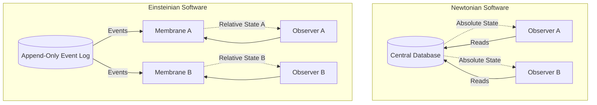

# The Physics of the Operational Field: Newtonian vs. Einsteinian Software

## Introduction to the Paradigms

For decades, the software industry has operated under a **Newtonian paradigm**. In Newtonian software, state is treated as an absolute truth. A database row exists in a single, objective state, and operations (like CRUD or REST calls) act upon this state in a linear, predictable fashion. This model assumes that "now" is the same everywhere across the system, much like classical physics assumes an absolute universe. 

However, as systems scale globally and become highly distributed, this illusion breaks down. We enter the realm of **Einsteinian software**. Here, state is no longer an absolute monolith but rather a relativistic phenomenon. Information travels at finite speeds (the speed of network latency), and observers in different parts of a distributed system may perceive the sequence of events differently. 

The **Operational Field** embraces this reality. Instead of fighting against the speed of light to maintain artificial global consistency, it treats operations as fields of localized interaction.

## Relativity of State

In an Einsteinian software architecture, state is a local derivation. It is calculated by applying a verifiable history of operations (events) to a known baseline. 

The core equation of the TrueX framework, **A = μ(O)**, perfectly encapsulates this:
- **A (Reality/State):** The current localized view of the system.
- **μ (The Membrane/Function):** The local interpretation or processing context.
- **O (The Operational History):** The sequence of verifiable events.

Because **O** can be observed differently depending on latency and network partitions, **A** is inherently relative to the observer. 

## Thermodynamics of Computation

Just as physical systems are governed by the laws of thermodynamics, computational systems are governed by the **Thermodynamics of Computation**. Over time, systems trend toward maximum entropy—this is the phenomenon commonly known as "software rot."

In traditional (Newtonian) software, mutability is the primary driver of entropy. Every update or delete operation destroys historical context, releasing "computational heat" and leaving behind a chaotic, untraceable state.

To counteract this, the Operational Field introduces strict conservation laws:
1. **No Information Destruction:** Data is only appended, never overwritten.
2. **Reversibility:** Any state can be logically reconstructed by replaying the event log from a known zero-point.

### Muri, Mura, and Muda in Software

When systems violate computational thermodynamics, they generate waste. Borrowing from lean manufacturing:
- **Muri (Overburden):** Forcing a single database to handle global locks, causing massive latency.
- **Mura (Unevenness):** Unpredictable API response times due to blocking operations.
- **Muda (Waste):** The lost historical context when a record is UPDATEd or DELETEd.

By treating the Operational Field as an immutable, append-only log, we eliminate **Muda** (no history is lost) and significantly reduce **Muri** (by decentralizing state calculation to the edges).

## Comparative Analysis

| Feature | Newtonian Software (CRUD/REST) | Einsteinian Software (Operational Field) |
| :--- | :--- | :--- |
| **State** | Absolute, global, mutable. | Relative, local, immutable. |
| **Truth** | The current value in the database. | The sequence of verifiable operations (VKG). |
| **History** | Overwritten and lost (Muda). | Preserved forever via append-only logs. |
| **Consistency** | Faked via global locks and high latency. | Eventual, mathematically proven via receipts. |
| **Entropy** | High. Constant refactoring required. | Low. Time-travel debugging built-in. |
| **Architecture** | N-Tier, Monolithic Databases. | Local-First, Actor Models, Event Sourcing. |

## The Verified Knowledge Graph (VKG)

In the Operational Field, data is structured as a Verified Knowledge Graph. Every node is a state, and every edge is an operation cryptographically signed by an actor. Because the graph is verified at every step, the integrity of the system does not rely on a central authority but on the laws of mathematics.

This means that any observer can independently verify the entire history of the system, calculating their own relative state without needing to trust a centralized "source of truth."

## The Role of the Observer

In quantum mechanics and relativity, the observer plays a crucial role in determining the outcome of an event. Similarly, in the Operational Field, the membrane ($\mu$) acts as the observer. The exact same operational history ($O$) might be interpreted differently by different membranes depending on their security clearance, temporal window, or specific business logic.

This decoupling of the **what happened** (the events) from the **what it means** (the state) is the ultimate realization of Einsteinian software design. It provides a level of flexibility and resilience that is completely unachievable in rigid, Newtonian CRUD applications.

## Conclusion

Embracing the physics of the Operational Field requires a fundamental shift in how we think about software. We must stop trying to build classical clocks in a relativistic universe. By adopting the principles of relativity, thermodynamics, and cryptographic verification, we can build systems that are infinitely scalable, completely verifiable, and immune to the ravages of software rot.