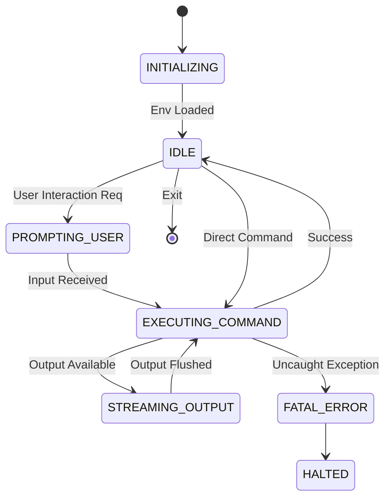

# CLI Calculus

## 1. Overview
CLI Calculus is a formal logic system used to model, verify, and enforce the state transitions of the Command Line Interface. It treats user inputs as events and CLI views as states in a finite state machine, applying mathematical rigor to UI workflows.

## 2. Core Axioms

Let \( C \) be the set of all CLI Commands.
Let \( S \) be the set of all UI States (e.g., Prompting, Executing, Error, Success).
Let \( E \) be the environment variables mapping \( String \rightarrow String \).

### 2.1 The Transition Function
The core transition is defined as:
\[ \Delta: S \times C \times E \rightarrow S \]

This means that for any given State, Command, and Environment, there is exactly ONE valid next State. Non-determinism is strictly forbidden.

## 3. Strict Definitions

### 3.1 `CLIState` Enum
```typescript
enum CLIState {
  INITIALIZING = 'INITIALIZING',
  IDLE = 'IDLE',
  PROMPTING_USER = 'PROMPTING_USER',
  EXECUTING_COMMAND = 'EXECUTING_COMMAND',
  STREAMING_OUTPUT = 'STREAMING_OUTPUT',
  HALTED = 'HALTED',
  FATAL_ERROR = 'FATAL_ERROR'
}
```

### 3.2 Command AST
All CLI inputs are parsed into an Abstract Syntax Tree (AST) before execution.
```typescript
interface CommandAST {
  binary: string;
  subcommand?: string;
  flags: Record<string, boolean | string | number>;
  positionalArgs: string[];
}
```

## 4. Logical Invariants

### 4.1 Re-entrancy Prohibition
If \( s_n = \text{EXECUTING\_COMMAND} \), then \( \Delta(s_n, c) \) is undefined for all \( c \) unless \( c \) is a system-level interrupt (`SIGINT`).

### 4.2 State Closure
The system MUST always eventually reach either `IDLE` or `HALTED`. Infinite loops in `EXECUTING_COMMAND` violate the calculus and must be broken by a predefined timeout theorem.

## 5. API Signatures

### `parseCommand(rawInput: string): CommandAST`
Parses raw terminal input into a formal `CommandAST`.
- **Throws:** `SyntaxError` if flags are malformed.

### `evaluateTransition(currentState: CLIState, ast: CommandAST, env: Record<string,string>): CLIState`
Calculates the next state based on the calculus rules.
- **Returns:** The subsequent `CLIState`.

## 6. Architecture Diagram



## 7. Exhaustive Error Catalog
- `CalculusUndefinedTransitionError`: Attempted to apply a command to a state where it is not mathematically defined.
- `CalculusTimeoutError`: A command exceeded its \( T_{max} \) limit in the execution state.
- `ASTValidationError`: The input violated the grammar rules of the CLI.
- `CalculusInvariantBreach`: Occurs when a command results in state corruption or violates the defined transition function.
