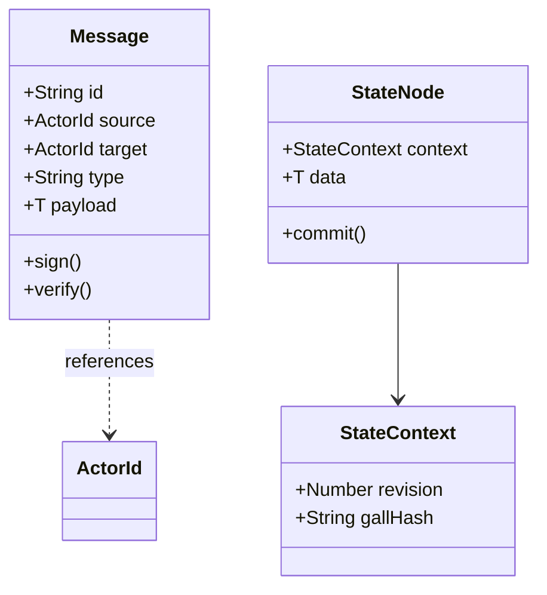

# Core Primitives

## 1. Overview
This document exhaustively details the fundamental types, interfaces, and memory structures utilized within the system. These core primitives are the atomic building blocks of the architecture and are immutable by design.

## 2. Fundamental Types

### 2.1 Identity and Addressing
```typescript
type ActorId = `act_${string}`;
type SessionId = `ses_${string}`;
type CorrelationId = `cor_${string}`;
```
- **ActorId**: A globally unique identifier for any active entity capable of emitting or receiving events.
- **SessionId**: Defines the temporal bounds of an active connection or interaction context.
- **CorrelationId**: Used to trace a single logical operation across multiple asynchronous boundaries.

### 2.2 Time and Sequencing
```typescript
type EpochMs = number;
type MonotonicTick = bigint;
```
- **EpochMs**: Unix time in milliseconds. Must not be used for causal ordering.
- **MonotonicTick**: A purely monotonic counter guaranteed never to decrease within a single process.

## 3. Structural Interfaces

### 3.1 The `Message` Primitive
Every piece of data that moves between actors MUST conform to the `Message` interface.

```typescript
interface Message<T = unknown> {
  id: string;
  source: ActorId;
  target: ActorId | '*';
  timestamp: EpochMs;
  correlationId?: CorrelationId;
  type: string;
  payload: T;
  signature?: string;
}
```

### 3.2 The `State` Primitive
```typescript
interface StateContext {
  revision: number;
  lastUpdated: EpochMs;
  gallHash: string;
}

interface StateNode<T> {
  context: StateContext;
  data: Readonly<T>;
}
```

## 4. API Signatures

### `createActorId(): ActorId`
Generates a mathematically unique Actor ID using a high-entropy CSPRNG.

### `packMessage<T>(source: ActorId, target: ActorId, type: string, payload: T): Message<T>`
Safely constructs a `Message` object, ensuring all invariant constraints (like generating a unique `id` and `timestamp`) are met.

### `verifyMessageSignature(message: Message): boolean`
Validates the cryptographic signature of a message against the `source`'s public key.

## 5. Immutability Invariants
1. Primitives MUST be deeply frozen upon instantiation (`Object.freeze`).
2. Any modification to a `StateNode` MUST result in a completely new `StateNode` with an incremented `revision`.
3. `Message` objects are append-only. Middleware may wrap them, but MUST NOT alter original fields.

## 6. Architecture of Primitives



## 7. Memory Layout Considerations
Primitives are designed to be efficiently packed in V8. Arrays of `ActorId` should remain monomorphic. `Message` and `StateNode` structures are carefully aligned to prevent hidden class deoptimization. All core primitives support zero-copy serialization mechanisms where possible.
