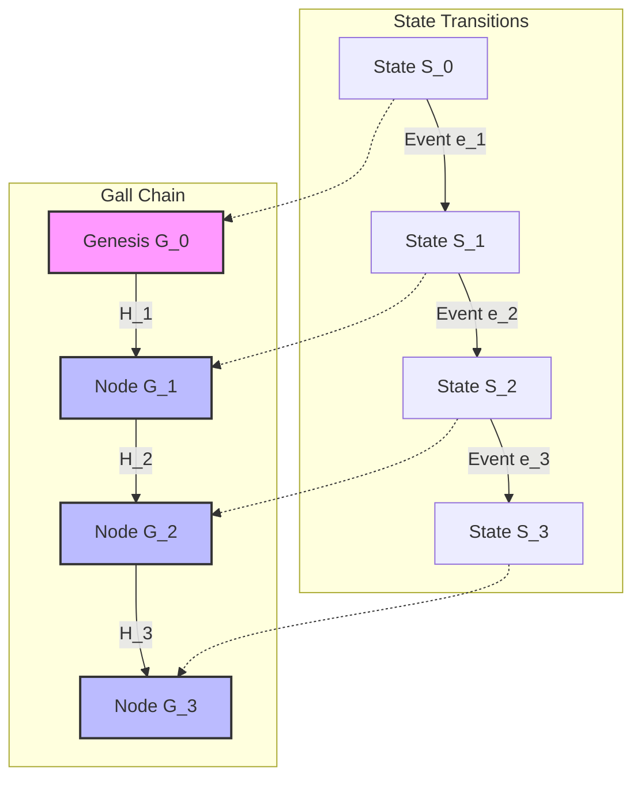

# Gall Sequencing Law

## 1. Overview
The Gall Sequencing Law establishes the absolute temporal ordering and causality enforcement within the Truex architecture. It defines how actions, states, and transitions are deterministically ordered using a continuous, cryptographically linked hash chain (the "Gall Chain"). This law prevents sequence violations, state tearing, and replay attacks across distributed execution boundaries.

## 2. Mathematical Definition

Let \( S \) be the set of all valid system states.
Let \( E \) be the set of all executable events.
Let \( H \) be a cryptographic hash function (specifically BLAKE3).

For any transition \( S_n \xrightarrow{e} S_{n+1} \), the Gall Sequence defines the structural invariant:
\[ G_{n+1} = H(G_n || S_n || e || S_{n+1}) \]
Where \( G_0 \) is the genesis hash of the system.

### 2.1 Invariant Enforcement
The sequence is strictly monotonic.
\[ \forall i < j, Sequence(G_i) < Sequence(G_j) \]

## 3. Formal Signatures

### `type GallHash = string;`
A 256-bit BLAKE3 hash represented as a hex string.

### `interface GallSequenceNode`
```typescript
interface GallSequenceNode {
  previousHash: GallHash;
  eventPayload: unknown;
  stateSnapshotHash: GallHash;
  timestamp: number;
  sequenceId: bigint;
  currentHash: GallHash;
}
```

### `verifySequence(node: GallSequenceNode, previousNode: GallSequenceNode): boolean`
Validates that `node` is the legal successor to `previousNode`.
- **Arguments:**
  - `node`: The target sequence node to verify.
  - `previousNode`: The presumed preceding node.
- **Returns:**
  - `true` if `node.previousHash === previousNode.currentHash` and `node.currentHash` is computationally valid.
  - `false` otherwise.
- **Throws:** `GallSequenceViolationError` if structural integrity is compromised.

## 4. Mermaid Architecture Diagram



## 5. Causal Consistency Models
The Gall Law mandates **Causal Consistency**. If Event A happens before Event B in the sequence, all subsequent states MUST reflect the effects of Event A before reflecting the effects of Event B.

### 5.1 Vector Clocks Integration
While the Gall Chain provides total global ordering, local concurrency is managed via vector clocks embedded within the `eventPayload`.
- `VectorClock`: `Record<NodeId, SequenceCounter>`

## 6. Exhaustive List of Error Types
1. `GallSequenceViolationError`: The `previousHash` does not match the actual previous hash.
2. `GallCausalityError`: Vector clock timestamps indicate a time-travel or paradox condition.
3. `GallHashMismatchError`: The computed `currentHash` does not equal the provided `currentHash`.
4. `GallStateTearingError`: The `stateSnapshotHash` fails to represent a complete, valid system state.

## 7. Authoritative Rules
- **Rule 1:** A node MUST NOT emit an event without first linking it to the latest known `GallHash`.
- **Rule 2:** The system MUST halt processing if a `GallHashMismatchError` is detected.
- **Rule 3:** The `timestamp` MUST be monotonically increasing, but is NOT the primary causality mechanism (the hash chain is).
