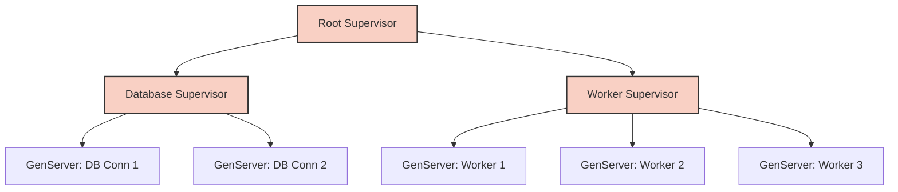

# OTP Equivalence API

## 1. Overview
The OTP Equivalence API provides an actor-model, fault-tolerant supervision tree structure modeled strictly after Erlang/Elixir's OTP (Open Telecom Platform). This guarantees process isolation, automatic recovery, and robust state management via GenServers and Supervisors.

## 2. Core Concepts
- **Actor (Process):** An isolated unit of execution with its own state and message queue.
- **GenServer (Generic Server):** A standardized pattern for client-server behavior within actors.
- **Supervisor:** A specialized actor whose only job is to monitor and restart other actors.

## 3. Strict Definitions & Types

### 3.1 Supervisor Strategies
```typescript
enum SupervisionStrategy {
  ONE_FOR_ONE = 'ONE_FOR_ONE',
  ONE_FOR_ALL = 'ONE_FOR_ALL',
  REST_FOR_ONE = 'REST_FOR_ONE'
}
```

### 3.2 GenServer Callbacks
To implement a GenServer, a class MUST implement the following interface:
```typescript
interface GenServerBehavior<State, Request, Reply> {
  init(args: any[]): State;
  handleCall(request: Request, from: ActorId, state: State): [Reply, State];
  handleCast(msg: Request, state: State): State;
  handleInfo(info: any, state: State): State;
  terminate(reason: string, state: State): void;
}
```

## 4. API Signatures

### `startLink<T extends GenServerBehavior>(module: T, args: any[]): ActorId`
Starts a GenServer and links it to the calling process. If the GenServer crashes, the caller receives an exit signal.
- **Returns:** The generated `ActorId` of the new process.

### `call(serverRef: ActorId, request: any, timeoutMs?: number): any`
Sends a synchronous request to the GenServer and waits for the reply.
- **Throws:** `TimeoutError` if the server does not reply within `timeoutMs`.

### `cast(serverRef: ActorId, msg: any): void`
Sends an asynchronous request to the GenServer and returns immediately.

## 5. The Supervision Tree Invariant
A Supervisor MUST NOT contain business logic. Its state consists exclusively of the PIDs (ActorIds) of its children and its restart strategy.
\[ S_{state} = \{ C_1, C_2, \dots, C_n \} \]
If \( C_i \) exits with reason other than `normal`, the Supervisor evaluates the `SupervisionStrategy` and takes restorative action.

## 6. Architecture Diagram



## 7. Exhaustive Restart Reasons
1. `normal`: The process completed its work intentionally. (No restart).
2. `killed`: Terminated forcefully via `kill(pid)`. (Restart based on config).
3. `shutdown`: Clean shutdown requested by supervisor.
4. `exception`: Unhandled runtime exception in the process heap. (Always restart).

## 8. Message Passing Guarantees
All inter-process communication via `call` and `cast` provides **At-Most-Once** delivery semantics. Ordering is guaranteed between any two specific actors, but not globally, preserving strict mathematical OTP compliance.
