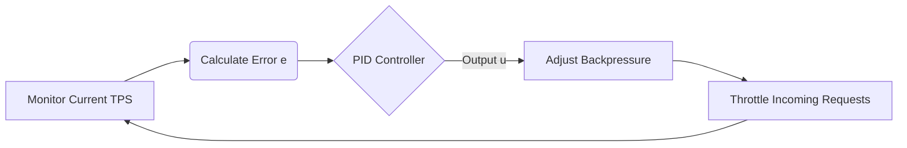

# TPS Control Laws

## 1. Overview
The TPS (Tokens Per Second) Control Laws define the mathematical and systemic feedback loops that regulate throughput, token generation, and system load. This ensures the system does not exceed thermal, financial, or computational boundaries while maximizing efficiency.

## 2. Mathematical Control Theory

The TPS regulation uses a Proportional-Integral-Derivative (PID) controller formula.

Let \( T_t \) be the Target TPS.
Let \( C_t \) be the Current TPS at time \( t \).
Let \( e(t) = T_t - C_t \) be the error function.

The control output \( u(t) \) (which adjusts the rate-limiter backpressure) is defined as:
\[ u(t) = K_p e(t) + K_i \int_{0}^{t} e(\tau) d\tau + K_d \frac{de(t)}{dt} \]

Where \( K_p \), \( K_i \), and \( K_d \) are the tuning coefficients.

## 3. Strict Definitions

### 3.1 Token Bucket Invariants
The rate limiting uses a strict Token Bucket algorithm.
- `BucketCapacity` (\( B_{max} \)): Maximum burst capacity.
- `RefillRate` (\( R \)): Tokens added per second.

Invariant: \( \text{Tokens}(t) \le B_{max} \) for all \( t \).

### 3.2 TPS Metrics Structure
```typescript
interface TPSMetrics {
  currentTps: number;
  targetTps: number;
  pidOutput: number;
  bucketLevel: number;
  droppedRequests: number;
  movingAverage: number;
}
```

## 4. API Signatures

### `consumeTokens(amount: number): boolean`
Attempts to consume `amount` tokens from the bucket.
- **Returns:** `true` if successful, `false` if the bucket lacks sufficient tokens (triggers backpressure).

### `updatePIDController(currentMetrics: TPSMetrics): number`
Runs the PID calculation.
- **Returns:** The new `u(t)` backpressure delay in milliseconds.

### `getSystemLoad(): number`
Returns a normalized float between `0.0` and `1.0` representing total TPS saturation.

## 5. Control Loop Flow



## 6. Thermal and Financial Invariants
- **Thermal Circuit Breaker:** If \( C_t > T_{critical} \) for \( > 5 \) seconds, the system MUST emit `SystemHaltEvent` and set \( R = 0 \).
- **Financial Quota:** If \( \int C_t dt > \text{Budget} \), the API key is strictly locked. No tokens can be consumed.

## 7. Exhaustive Argument Lists
- `setTargetTPS(target: number)`
  - `target`: Must be a positive integer \( > 0 \). Max value bounded by system max throughput config.
- `tunePID(kp: number, ki: number, kd: number)`
  - `kp`: Proportional gain.
  - `ki`: Integral gain.
  - `kd`: Derivative gain.

## 8. Saturation Protocols
When backpressure `u(t)` exceeds the `MaxDelayTolerance`, the system immediately enters load shedding. Requests are deterministically dropped using a Random Early Detection (RED) curve to prevent cascading systemic failure.
