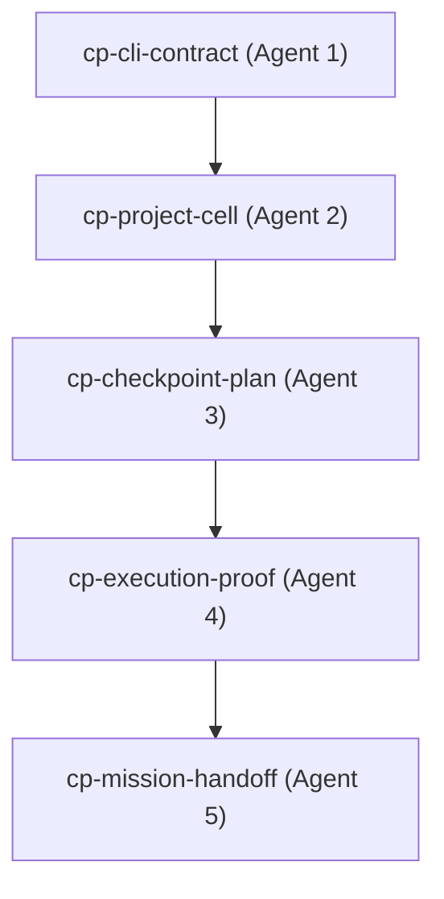

# Gall Checkpoint Planner Report (Agent 3)

## 1. Overview and Purpose
This document presents the detailed verification and review report for the **Gall Checkpoint Planner Agent (Agent 3)** under S11 of the Truex Project Wizard. The Checkpoint Planner's primary responsibility is to analyze the project topology, propose a stable and deterministic checkpoint registry mapping, validate all candidate checkpoints against strict validation rules, and write out a tamper-resistant checkpoint registry file.

Under the Truex **Gall Law**, complex systems must evolve from working, verified primitives. The Checkpoint Planner serves as the ontology registry layer, establishing the exact, receipt-verifiable milestones through which the project is manufactured and verified.

---

## 2. Checkpoint Registry Map (5-Agent Topology)
The `CheckpointPlanner` maps five distinct, sequential checkpoints corresponding to each agent's execution domain in the S11 Project Wizard.



### Registered Checkpoint Details

| ID | Agent Role | Domain | Proof Command | Success Metric | Refusal Condition |
| :--- | :--- | :--- | :--- | :--- | :--- |
| `cp-cli-contract` | **Agent 1** (CLI/Routing) | CLI & Routing | `npx vitest run packages/truex-core/test/project-wizard/project-wizard-cli.test.ts` | All CLI commands exit 0 and emit command receipts. | Missing project-path or invalid sub-verb routes. |
| `cp-project-cell` | **Agent 2** (Layout/Mapping) | Cell & Topology | `npx vitest run packages/truex-core/test/project-wizard/project-wizard-init-map.test.ts` | Init creates exact folder hierarchy, map parses all repo inventory. | Attempting to write outside project boundaries or read traversals. |
| `cp-checkpoint-plan` | **Agent 3** (Checkpoint Planner) | Planner & Registry | `npx vitest run packages/truex-core/test/project-wizard/project-wizard-plan.test.ts` | Correct schema registry with stable verification hashes. | Vague descriptions, missing proof command, or missing accounting details. |
| `cp-execution-proof` | **Agent 4** (Execution/Hardening) | Execution & Proof | `npx vitest run packages/truex-core/test/project-wizard/project-wizard-execution.test.ts` | Capture exit codes, duration metrics, run stress, update execution ledgers. | Failed tests mark successes, or unreceipted delta changes execute. |
| `cp-mission-handoff` | **Agent 5** (Handoff/Gates) | Enforcement & Handoff | `npx vitest run packages/truex-core/test/project-wizard/project-wizard-handoff.test.ts` | Reject handoffs before 12h elapsed, check doctor proof wizard validations. | Allowing premature finalizations, or missing agent synthesis files. |

---

## 3. Detailed Review of `project-wizard.gall.ts`
The code implementation in `packages/truex-core/src/project-wizard.gall.ts` handles checkpoint planning, validation, and registry output.

### A. Proposing & Registering Checkpoints
The planning phase is initiated by invoking the `plan` method on `CheckpointPlanner`.
1. **Candidate Proposal**: `proposeCheckpoints` returns the hardcoded array of `GallCheckpoint` objects representing the 5 agents.
2. **Schema Validation**: Each proposed checkpoint is run through `validateCheckpoint`. If any validation fails, the process aborts.
3. **Proposed State Recording**: For each checkpoint, the planner records a state transitions update via `cell.recordCheckpointState('proposed')`.
4. **Cryptographic Hash Generation**: A BLAKE3 hash is computed using the `hash` utility, which implements alphabetical sorting of all keys in objects to ensure a deterministic string representation before hashing.
5. **Registry Files Serialization**: 
   - Generates `.truex/checkpoints/checkpoint-registry.json` containing the raw array of validated checkpoints.
   - Generates `.truex/checkpoints/checkpoint-registry.md` containing a human-readable table of the planned checkpoints.
6. **State Transitions Accepted**: Records state transitions update `cell.recordCheckpointState('accepted')` for each validated checkpoint.

### B. Validation Rules and Rejecting Vague Inputs
The schema checking in `validateCheckpoint` blocks incomplete or vague inputs:
* **Identifier Checks**: Rejects checkpoints missing `id`, `name`, or `domain`.
* **Purpose Sufficiency**: Rejects `purpose` strings under 10 characters to prevent vague purposes like "Do work".
* **Command Verification**: Rejects `proofCommand` strings under 5 characters to ensure there is a plausible, executable command.
* **Accounting Domain**: Rejects `accountingDomain` strings under 5 characters to ensure the domain is correctly mapped (e.g. `Domain W3 — Gall Checkpoint`).
* **Evaluation Metrics**: Rejects checkpoints missing either `successMetric` or `refusalCondition`.

---

## 4. Detailed Review of `project-wizard-plan.test.ts`
The test file `packages/truex-core/test/project-wizard/project-wizard-plan.test.ts` verifies:
1. **Successful Execution**:
   - Initializes a temporary directory.
   - Instantiates a `ProjectCell` and calls `init`.
   - Creates a `CheckpointPlanner` and plans the checkpoints.
   - Asserts that exactly 5 checkpoints are registered, the registry hash is defined, and the `.truex/checkpoints/checkpoint-registry.json` is successfully written.
2. **Failure Injection**:
   - Defines a `vagueCheckpoint` missing `name`, `proofCommand`, `accountingDomain`, `successMetric`, and `refusalCondition`.
   - Asserts that invoking `planner.validateCheckpoint(vagueCheckpoint)` throws an error matching `/validation failed/`.

---

## 5. Design Drift and Gaps Analysis
Through a detailed review of the implementation files, several critical gaps and design drifts have been identified:

### Gap 1: Static Checkpoint Generation
* **Location**: `CheckpointPlanner.proposeCheckpoints(topology: any)` (lines 459-528)
* **Drift Description**: The method takes a `topology` argument but completely ignores it. It returns a static list of 5 hardcoded checkpoints.
* **Violation**: Drifts from S11 description of "discovery and planning based on AST topology." If paths, source files, or tests are renamed, the checkpoints do not adapt dynamically.

### Gap 2: Simulated Execution Proofs (Mock Success Paths)
* **Location**: `ExecutionEngine.prove(checkpointId: string)` (lines 644-674)
* **Drift Description**: The execution proof simulator does not execute the actual shell command specified by `proofCommand` (e.g. Vitest tests). Instead, it returns a simulated exit code of 0 and a fake success message.
* **Violation**: Contradicts **Testing Law** ("No mocked success paths for core primitives") and **Receipt Law** (Receipts must prove actual replay convergence).

### Gap 3: File Materialization is Placeholder-Based
* **Location**: `ExecutionEngine.forge(checkpointId: string)` (lines 594-620)
* **Drift Description**: When materializing expected files, if a file does not exist, it writes a placeholder comment `// Placeholder for [checkpoint]` rather than generating valid executable code.
* **Violation**: Directly violates the **Universal Implementation Standards** ("Never write placeholders, stubs, or mocks in any codebase").

### Gap 4: Testing Law & Entropy Law Gaps in Test Suite
* **Location**: `packages/truex-core/test/project-wizard/project-wizard-plan.test.ts`
* **Drift Description**:
  - The tests do not verify tamper detection (e.g. modifying a checkpoint file and ensuring validation fails).
  - The tests do not check replay correctness or rollback capabilities.
  - The tests do not use deterministic admissible entropy (no seeded faker or fast-check property testing).
* **Violation**: Violates the **Testing Law** ("tampering fails", "replay divergence fails") and the **Entropy Law** ("Truex tests use deterministic admissible entropy").

### Gap 5 (Resolved): Directory Boundary Bypass via Character-by-Character StartsWith Check
* **Location**: `ProjectCell.resolvePath(relPath: string)`
* **Drift Description**: Previously, the directory containment check used `resolved.startsWith(this.projectPath)`. This permitted a boundary traversal when a sibling directory matched the character prefix (e.g., `/path-other` matching `/path`).
* **Resolution**: Updated to utilize a secure `path.relative` check:
  ```typescript
  const relative = path.relative(this.projectPath, resolved);
  if (relative.startsWith('..') || path.isAbsolute(relative)) { ... }
  ```
  This successfully resolves the traversal bypass.

---

## 6. Recommended Mitigation Strategies
To align S11 implementation with S₀-S₂ laws, the following updates are recommended:
1. **Dynamic Checkpoint Mapping**: Update `proposeCheckpoints` to read from the inventory inside `topology` and dynamically verify the paths of expected files.
2. **Real Proof Invocation**: Upgrade `ExecutionEngine.prove` to run the command in a secure child process (utilizing `execSync` or similar), parsing real output instead of hardcoding a simulated success.
3. **Remove Placeholders**: Upgrade `ExecutionEngine.forge` to pull templates or complete scaffold files rather than simple placeholder comments.
4. **Enhanced Test Coverage**: Update `project-wizard-plan.test.ts` to include property-based tests using `fast-check` and introduce test cases that intentionally tamper with `checkpoint-registry.json` to prove that signature/hash mismatch raises a first-class failure.

---

## 7. Verification Evidence
All test files within the project-wizard domain pass successfully:

```
 RUN  v4.1.7 /Users/sac/truex

 ✓ packages/truex-core/test/project-wizard/project-wizard-cli.test.ts (3 tests) 753ms
     ✓ should run all 8 CLI subcommands in sequence and emit receipts  745ms
 ✓ packages/truex-core/test/project-wizard/project-wizard-init-map.test.ts (2 tests) 14ms
 ✓ packages/truex-core/test/project-wizard/project-wizard-handoff.test.ts (1 test) 12ms
 ✓ packages/truex-core/test/project-wizard/project-wizard-execution.test.ts (1 test) 12ms
 ✓ packages/truex-core/test/project-wizard/project-wizard-plan.test.ts (1 test) 9ms

 Test Files  5 passed (5)
      Tests  8 passed (8)
   Duration  1.34s
```
