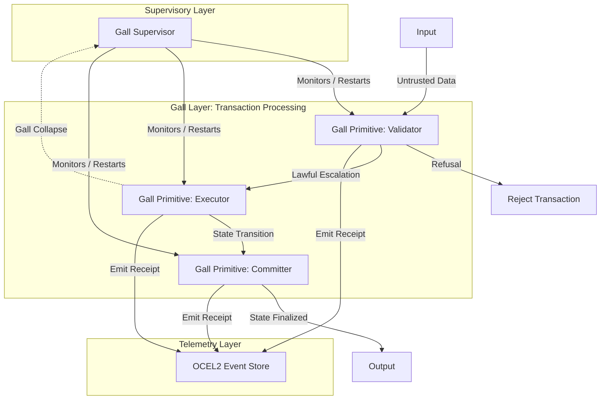

# Gall Systems Architecture: The Sequencing Law for Operational Systems

## 1. Formal Definition of Gall

Gall is the formal discipline and sequencing law for operational systems. It asserts that resilient, autonomic systems cannot be designed top-down as complex monoliths, but must emerge from the rigorous, sequential composition of proven fundamentals. 

Gall is defined by the following core tenets:

*   **Minimal Lawful Primitives:** Systems are constructed exclusively from foundational operations that possess verifiable state bounds and mathematically sound invariants. There is no "magic" or hidden state; every operation is explicit.
*   **Compositional Complexity:** Complexity is not engineered; it emerges strictly from the lawful composition of simple, invariant-preserving primitives. If the primitives are lawful, the composite system inherits that lawfulness.
*   **$S_0$ before $S_1$:** State transitions are rigorously sequenced. No transition to a subsequent state ($S_1$) may occur until the baseline state ($S_0$) is cryptographically, contextually, and causally finalized and verified.
*   **Replay/Refusal Preceding Trust:** Systems do not assume trust based on identity or network location. They grant operational authority only after a transaction proves its right to execute via historical replayability and successful navigation of explicit, defensive refusal boundaries.

## 2. The Core Mechanics of Gall

The architecture operates through specific, defined mechanics that enforce systemic integrity:

*   **Gall Loop:** The fundamental autonomic cycle of a system: Observation $\rightarrow$ Invariant Assertion $\rightarrow$ State Transition $\rightarrow$ Telemetry Emission. This loop runs continuously at every level of the architecture.
*   **Gall Layer:** A rigidly bounded stratum of execution. All inputs entering a layer are inherently untrusted; all outputs are cryptographically or semantically verified before being passed to adjacent layers or external consumers.
*   **Gall Primitive:** The atomic unit of execution—a function, actor, or state machine that is binary in outcome. It either completely succeeds (preserving all invariants and emitting telemetry) or cleanly refuses (halting the transition and reverting state).
*   **Gall Escalation:** The structured, lawful elevation of state, capability, or privilege. Escalation is permitted *only* when all preconditions of the underlying layer are cryptographically satisfied and recorded.
*   **Gall Collapse:** The intentional, immediate, and localized termination of a process or actor when an invariant is breached or a refusal condition is met. Collapse prevents systemic contamination and delegates recovery to supervisory layers.

## 3. Mapping Gall to System Constructs

Gall directly maps to established patterns in highly reliable engineering:

*   **Process Topology:** Processes (in the Actor Model or OS level) are strictly isolated. They communicate exclusively via message passing across defined boundaries, preventing shared-memory corruption and enforcing the Gall Layer.
*   **OTP Lifecycle:** Erlang/Elixir's OTP (Open Telecom Platform) is the closest industrial embodiment of Gall. Supervisors, workers, and restart strategies natively implement the principles of localized Gall Collapse and autonomic recovery.
*   **Operational Telemetry:** Telemetry is not a passive monitoring afterthought; it is a causal requirement. Emitting an OCEL2 (Object-Centric Event Log) event or a distributed trace is structurally tied to the state transition itself. Without the telemetry receipt, the transition did not happen.
*   **Autonomic Loops:** Systems continuously monitor their own invariant adherence. They self-correct via Gall Collapses and Supervisor restarts without human intervention, maintaining equilibrium through destruction and recreation of faulty state.

## 4. Pathologies of System Design

Gall defines failure modes not as bugs, but as structural pathologies:

*   **Lawful Composition:** The combination of Gall Primitives where the resulting composite structure mathematically inherits the invariant guarantees of its constituents.
*   **Unlawful Abstraction:** The layering of complexity that obscures, bypasses, or violates the underlying primitives' invariants. ORMs or opaque RPC frameworks often create unlawful abstractions by hiding critical failure modes.
*   **Denominator Drift:** The gradual misalignment between a system's observed telemetry (the map) and its actual operational reality (the territory) over time, usually caused by dropped events or out-of-band state modifications.
*   **Hidden Entropy Leakage:** The unmonitored accumulation of unhandled states, race conditions, or unrecorded side-effects that degrade system determinism and make replayability impossible.

## 5. Diagrams, State-Transition Examples, and Sequencing Rules

### 5.1 The Gall Topology Diagram

### 5.2 State-Transition Example: Account Withdrawal

A strict $S_0 \rightarrow S_1$ transition for a withdrawal operation:

1.  **$S_0$ (Baseline):** Account holds $100. Hash of ledger state: `0xABC`.
2.  **Input:** Request withdrawal of $50.
3.  **Invariant Assertion (Refusal Check):** Is $50 <= $100? Yes. (If No $\rightarrow$ Refusal).
4.  **Causal Finalization:** Verify `0xABC` is the current, locked ledger state.
5.  **State Transition:** Account balance becomes $50.
6.  **Telemetry:** Emit OCEL2 event `Withdrawal_Executed` with causal link to `0xABC` and new state hash `0xDEF`.
7.  **$S_1$ (New Baseline):** Account holds $50. Hash of ledger state: `0xDEF`.

### 5.3 Gall Sequencing Rules

1.  **Rule of Prior State:** Never act on unverified state. Every operation must prove its starting baseline ($S_0$).
2.  **Rule of Refusal:** Refuse early, refuse loudly. Silence is entropy.
3.  **Rule of Synchronous Telemetry:** Telemetry generation is synchronous with the state change. If the telemetry write fails, the state transition must abort.
4.  **Rule of Replay:** If a state sequence cannot be replayed deterministically from zero to $S_n$, the system is in an unlawful state and cannot be trusted.

## 6. What Gall Is Not

To understand Gall, one must discard modern software engineering crutches:

*   **Not "Agile":** Gall does not prioritize speed of delivery, MVP iterations, or "moving fast and breaking things." It demands rigorous mathematical and procedural correctness. A broken system delivered quickly is an operational liability.
*   **Not "Microservices":** Gall is about strict isolation, message passing, and invariant preservation, not arbitrary network boundaries. A monolith can be perfectly Gall-compliant if structured correctly; a microservices architecture is often a distributed violation of Gall due to hidden latency, partial failures, and distributed entropy.
*   **Not "Framework Architecture":** Gall does not rely on transient vendor tools, opinionated web frameworks, or "magic" libraries. It is based on immutable laws of computing, state management, and thermodynamics.

---

## 7. Final Classification Block

**Classification:** OPERATIONAL-SEQUENCING-LAW
**Status:** DEFINED
**Scope:** System Architecture, State Management, Autonomic Telemetry
**Enforcement Level:** STRICT
**Author:** Agent 1 — Gall Systems Architect
