# TRUEX C4 ARCHITECTURE MAP

**Status:** Mapped Live from Source AST + Tests + Receipts + Runtime Reports + WAL Topology
*This document is a receipted architecture control surface, dynamically generated and proven via `doctor prove architecture`.*

## 0. Generation Receipt

```yaml
generatedAt: 2026-05-24T08:48:09.719Z
astFilesScanned: 228
mappedFiles: 221
orphanFiles: 7
topologyHash: 27cc7abce1bfed9e6abaae073d0bf4d2c4f65de6d832b28638704071f54b825e
receiptHash: 962f49d0-9209-4481-8d84-b16cadc92756
diagramHash: e13371054a7004b3323c051895eb4a2c2645756197ad14a1482e1a53c3f8563e pending
doctorCommand: npx tsx scripts/truex.ts doctor prove architecture
```

## 1. System Landscape

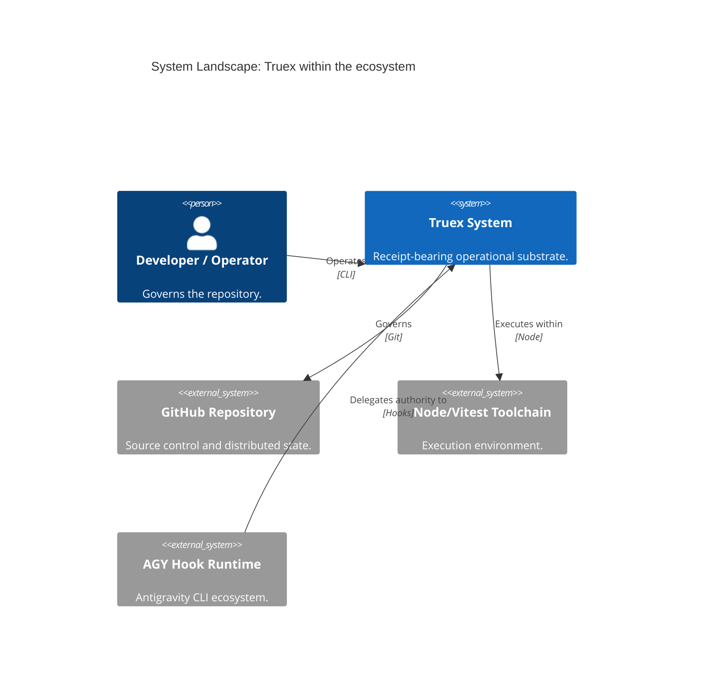

## 2. System Context

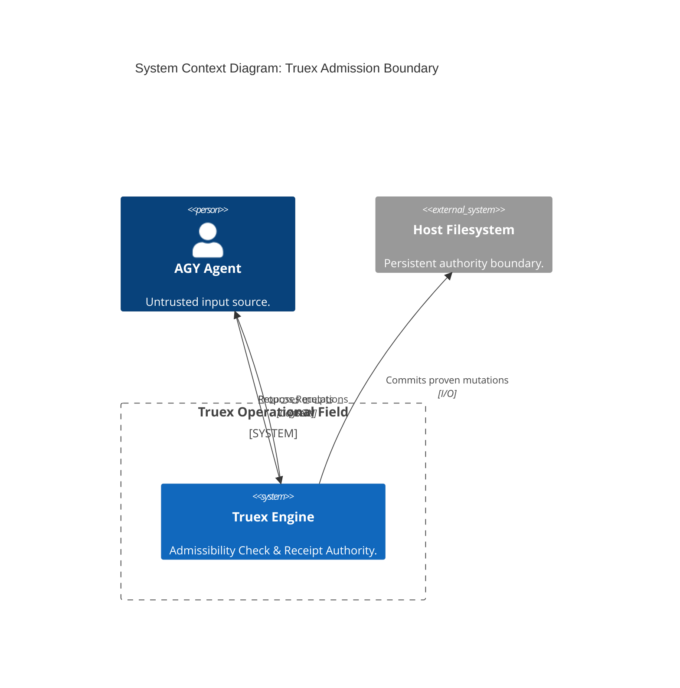

## 3. Container Architecture

```mermaid
C4Container
    title Container Diagram: Internal and Generated Artifact Boundaries

    System_Boundary(truex_sys, "Truex System") {
        Container(bridge, "AGY Bridge", "Node.js", "Intercepts agent actions.")
        Container(core, "Core Engine", "Node.js", "OTP, Membrane, Topology.")
        Container(obs, "Observatory", "Node.js", "Fact/AST extraction.")
        Container(doctor, "Doctest Verifier", "Node.js", "Proves Gall invariants.")
        Container(harness, "Benchmark Harness", "Node.js", "Stress/Failure verification.")
        
        ContainerDb(db, "gall_truex.db", "SQLite", "WAL & Receipts.")
        
        System_Boundary(artifacts, "Projection-Only Output") {
            Container(reports, "Generated Reports", "Markdown", "Observable feedback.")
            Container(diagrams, "Generated Diagrams", "Mermaid", "Topology feedback.")
        }
    }

    Rel(bridge, core, "Evaluates", "Calls")
    Rel(doctor, core, "Proves", "Calls")
    Rel(harness, core, "Stresses", "Calls")
    Rel(obs, artifacts, "Generates", "Writes")
    Rel(core, db, "Persists", "SQL")
```

## 4. Deployment Architecture

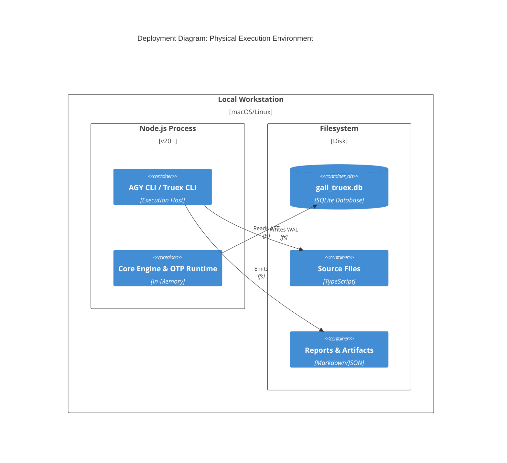

## 5. Component Diagrams

### 5.1 Core Engine Components


### 5.2 AGY Bridge Components
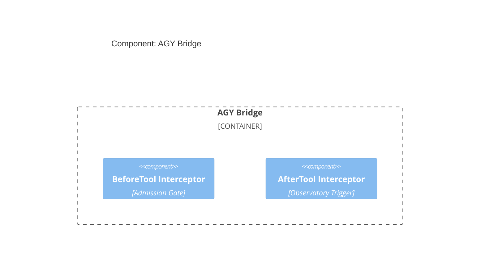

### 5.3 Observatory Components
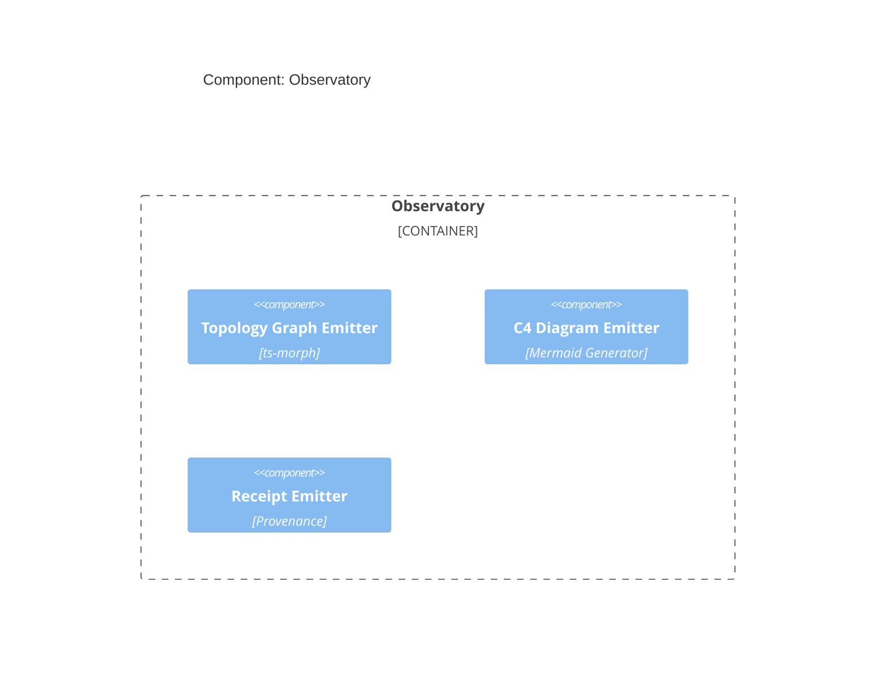

### 5.4 Persistence Membrane Components
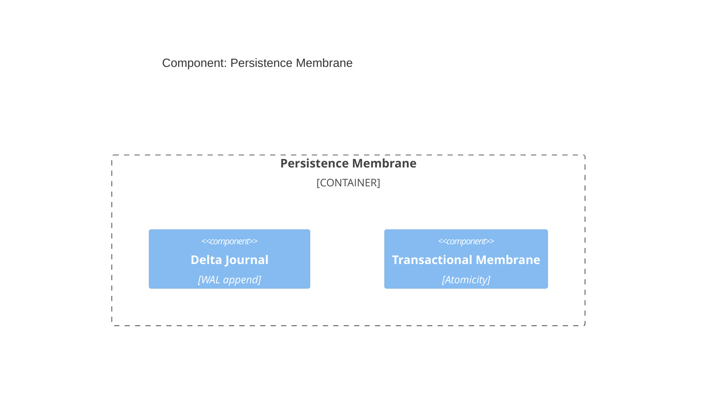

### 5.5 Doctor Proof System Components
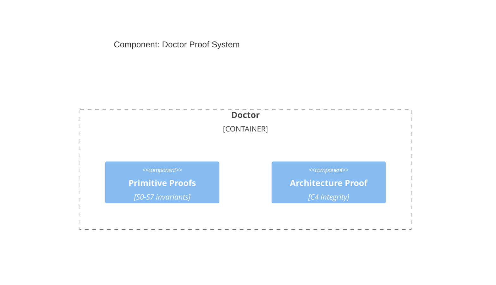

## 6. Dynamic Diagrams

### 6.1 Hook Execution
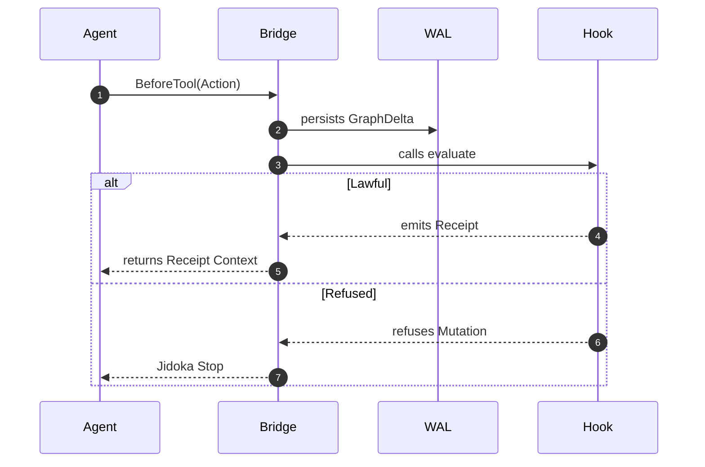

### 6.2 OTP Message Lifecycle
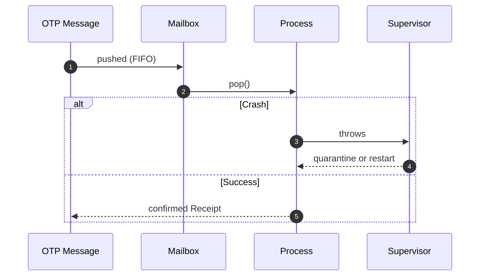

### 6.3 Cross-Hook Topology
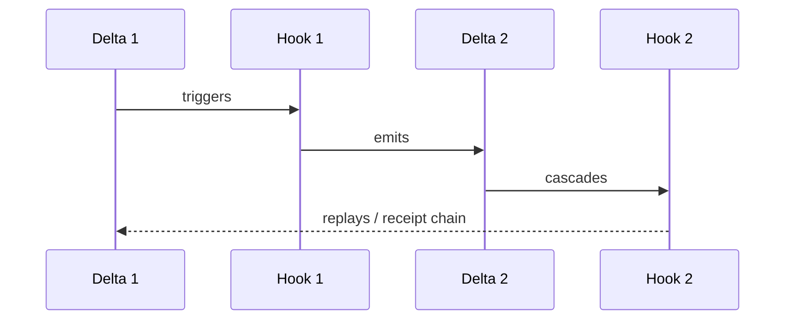

### 6.4 WAL Reconstruction
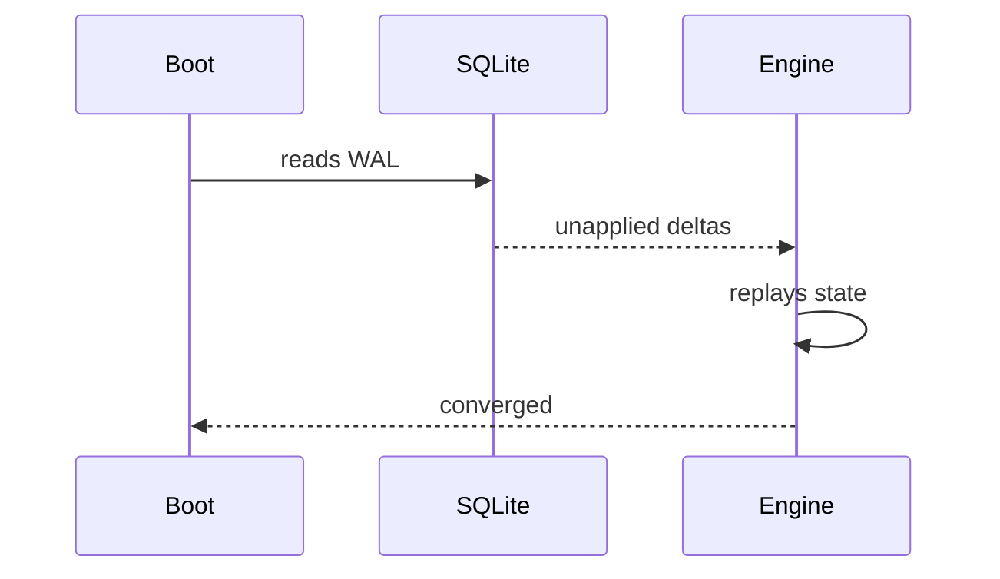

### 6.5 AGY BeforeTool/AfterTool
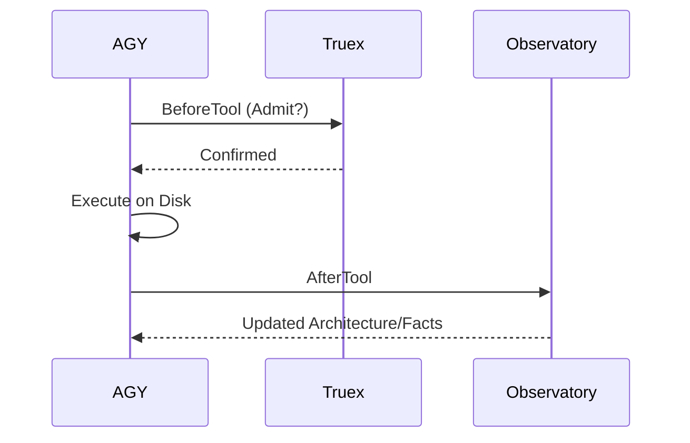

## 7. Code Maps

### 7.1 S0/S1 Primitives
*   `packages/truex-core/src/hash.ts`
*   `packages/truex-core/src/receipt.ts`
*   `packages/truex-core/src/replay.ts`
*   `packages/truex-core/src/context.ts`
*   `packages/truex-core/src/signature.ts`

### 7.2 S5 OTP
*   `packages/truex-core/src/hook-otp.gall.ts`
*   `packages/truex-core/test/hook-otp/hook-otp-mailbox.test.ts`
*   `packages/truex-core/test/hook-otp/hook-otp-supervisor.test.ts`
*   `packages/truex-core/test/hook-otp/hook-otp-nonmockable-stress.test.ts`

### 7.3 S6 Topology
*   `packages/truex-core/src/topology.gall.ts`
*   `packages/truex-core/test/topology/topology-chain-replay.test.ts`
*   `packages/truex-core/test/topology/topology-rollback-storm.test.ts`
*   `packages/truex-core/test/topology/topology-partial-order-vkg.test.ts`

### 7.4 S7 Membrane Replay
*   `packages/truex-core/src/membrane-replay.gall.ts`
*   `packages/truex-core/test/membrane-replay/membrane-reconstruction.test.ts`
*   `packages/truex-core/test/membrane-replay/membrane-crash-rollback.test.ts`

## 8. Architecture Accounting
This map actively indexes the codebase dependencies.
**Total Mapped Nodes:** 228

## 9. Orphans / Drift / Unmapped Files
❌ Found Orphans:
- scripts/fix-imports.ts
- scripts/mission/project-12h-finalization.ts
- packages/truex-core/src/ocel2-project-projection.gall.ts
- packages/truex-core/src/ocel2-project-types.ts
- packages/truex-core/src/ocpq-project-constraints.gall.ts
- packages/truex-core/src/powl-project-workflow.gall.ts
- packages/truex-core/src/project-wizard.gall.ts

## 10. Final Classification

```text
Truex C4 Architecture State:
- Alignment: Proven via Doctor
- Dynamic Coverage: Active
- Deployment Scope: Local-First (No Cloud)
- Orphan Count: 7
```

*Legend:*
*Solid edge = runtime call*
*Dashed edge = static import*
*Double edge = receipt lineage*
*Red edge = refusal*
*Blue edge = replay*
*Cylinder = persistent authority*