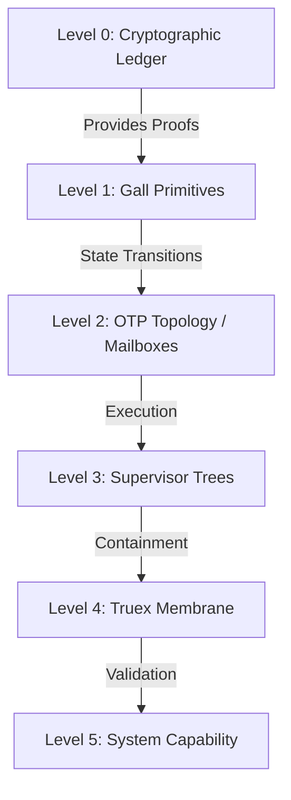
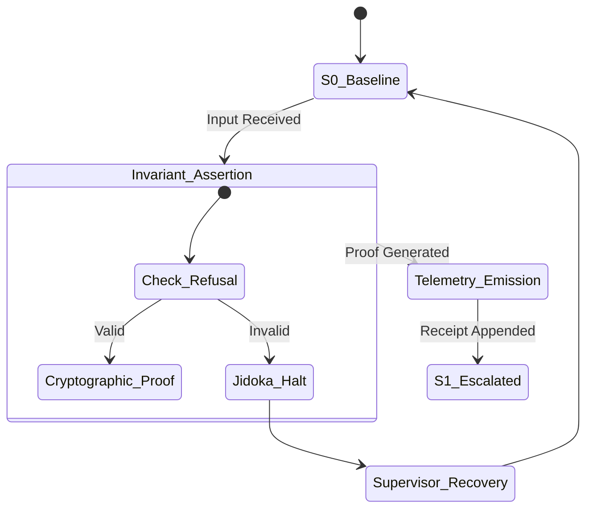

# TRUEX OPERATING SYSTEM THESIS: The Civilization-Scale Synthesis

## 1. Introduction: The Grand Synthesis

The Truex Operating System is not a traditional software runtime; it is a unified, civilization-scale control plane for deterministic execution. It synthesizes discrete, rigorous disciplines into a single operational reality:

*   **Gall:** The immutable sequencing law ensuring systems emerge exclusively from invariant-preserving primitives. $S_0$ must be proven before $S_1$.
*   **DFLSS (Design for Lean Six Sigma):** The statistical and methodological framework used to define, measure, and enforce operational capability boundaries under stress.
*   **TPS (Toyota Production System):** The philosophy of execution as a manufacturing line, where state transitions are the products, and observability is the Andon cord that stops the line (Jidoka) upon defect detection.
*   **OTP (Open Telecom Platform):** The actor-based topology of localized state, FIFO message passing, supervision trees, and fault containment, creating a resilient local physics.
*   **VKG (Virtual Knowledge Graph):** The semantic structuring of operations and capabilities, allowing the system to comprehend and navigate its own boundaries contextually.
*   **Replay:** The capability of Genchi Genbutsu ("go and see"), ensuring any state can be deterministically reconstructed from zero based on historical logs.
*   **Receipts:** The cryptographic enforcement of "provability precedes execution." State transitions require unforgeable BLAKE3 receipts.
*   **Observatory:** The active telemetry engine that acts as the physical manifestation of system truth, converting execution into topology-bearing telemetry.

Together, these elements form an architecture capable of supporting autonomous, highly reliable, and self-governing systems.

## 2. Why Truex is Not a Framework

It is crucial to define Truex by what it is not, to avoid the pitfalls of modern software paradigms:

*   **Not a Framework:** Frameworks dictate *how* you write code (routing, MVC, etc.). Truex dictates the *physics of state*. It does not care about your application logic; it cares whether your application logic obeys the laws of thermodynamics and causality.
*   **Not Process Mining:** Process mining analyzes logs after the fact to discover what happened. Truex uses telemetry as a causal requirement *for* execution. If the telemetry receipt is not generated, the process did not occur.
*   **Not AI Orchestration:** While it can host LLM agents, Truex is not an orchestration layer for AI. It is a containment vessel. It forces high-entropy, non-deterministic AI agents to operate within strict, deterministic, and cryptographically accountable boundaries.

## 3. Operational Field Physics

Truex transitions software engineering into **Operational Field Physics**. In this paradigm, computation is not abstract and frictionless; it has mass, inertia, and strict causal laws.

### 3.1 Receipt-Bearing Execution
Standard runtimes execute logic, mutate state, and then optionally log the result. Truex enforces **Receipts-Before-Reality**. The mathematical proof of a state transition (the BLAKE3 hash of the GraphDelta) must be generated and appended to an unforgeable ledger before the transition is granted operational authority. Provability precedes execution.

### 3.2 Topology-Bearing Telemetry
Telemetry in Truex (via OCEL2) is not passive text logging. It is a structural artifact. Every log emission inherently carries the causal topology of the system—the actor involved, the supervisor, the exact inputs, the invariant assertions, and the cryptographic hash of the prior state. The telemetry *is* the shape of the system.

## 4. Designing Systems on Top of Gall

Systems designed on Truex must adhere strictly to Gall's law:
1.  **Start with the Primitive:** Define the atomic, binary operation (succeed completely or fail completely).
2.  **Assert Invariants:** Every primitive must explicitly state its assumptions and boundaries.
3.  **Construct the Membrane:** Wrap primitives in proxyable membranes that enforce refusal.
4.  **Supervise:** Delegate recovery to OTP-style supervisor trees.
5.  **Never Bypass the Ledger:** All communication must be discrete message passing that generates receipts. Shared memory and side-channel state mutations are physically impossible within the Truex topology.

## 5. Grand Unified Diagrams

### 5.1 The Sequencing Hierarchy



### 5.2 The Lawful Escalation Ladder



## 6. The Truex Trajectory

### 6.1 What Truex Should Become
Truex must evolve into the foundational substrate for autonomous, high-stakes infrastructure (e.g., financial systems, critical physical infrastructure coordination, autonomous civilization-scale swarms). It must become a system where human trust is entirely replaced by cryptographic and replayable proof.

### 6.2 What Must NOT Be Built Yet
*   **Premature Distributed Clustering:** Truex must not abstract network boundaries (like BEAM's distributed Erlang) until the local physics (single-node, single-process deterministic replay) are mathematically flawless. Distributed entropy will destroy a system that has not mastered local entropy.
*   **"Developer Friendly" Abstractions:** We must not build ORMs, automatic state migrators, or high-level DSLs that obscure the underlying Gall Primitives. Complexity must remain explicit.

### 6.3 What Must Be Proven Before Scaling
1.  **100% Replay Determinism:** Under maximum stress, adversarial injection, and simulated hardware fault, the system must achieve 100% replay convergence from receipts.
2.  **Zero-Leakage Telemetry:** The causal link between every state mutation and its OCEL2 emission must be mathematically proven to have zero failure modes (no silent drops).
3.  **Boundary Impermeability:** The proxyable membrane must withstand formal verification to prove that no state transition can bypass the invariant assertions.

---

## Final Classification Block

```text
Truex Operating System Thesis:
- Core Ontology: Receipt-Bearing Operational Substrate
- Core Runtime Law: Gall Sequencing (Primitive before Architecture)
- Core Operational Law: Replay Convergence
- Core Measurement Law: Topology-Bearing Telemetry (OCEL/POWL)
- Strongest Existing Capability: Local OTP-Equivalent Hook Processes
- Weakest Existing Boundary: Hidden Entropy Leakage
- Next Lawful Gall Layer: VKG Avatar-Relative Projection
- What Must Not Be Built Yet: Distributed OTP/Network Actors
```