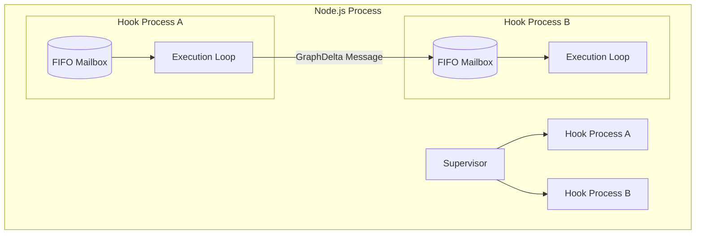
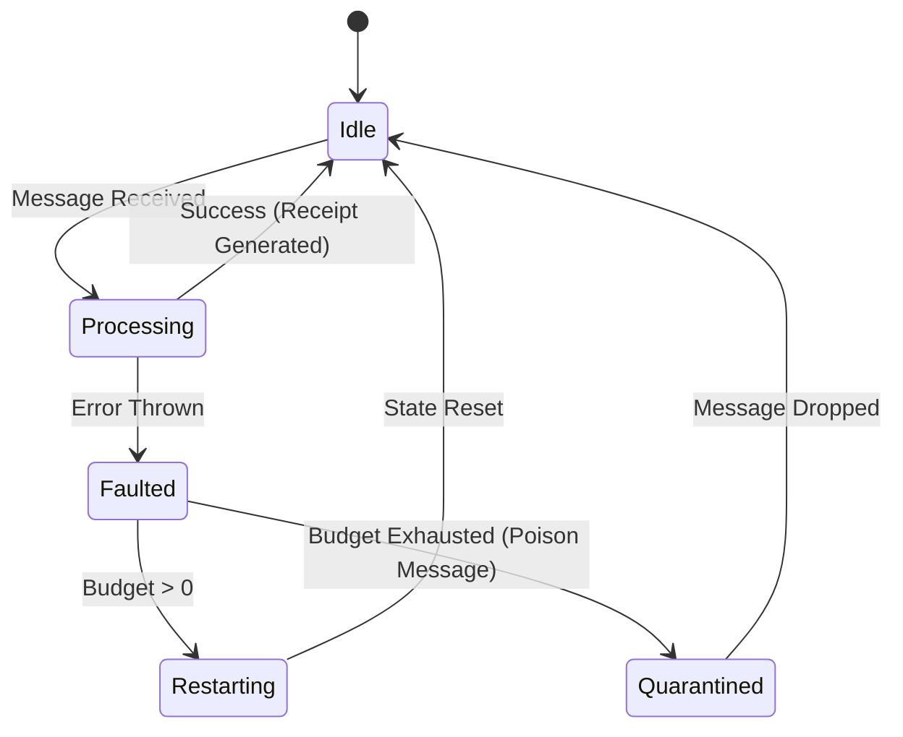
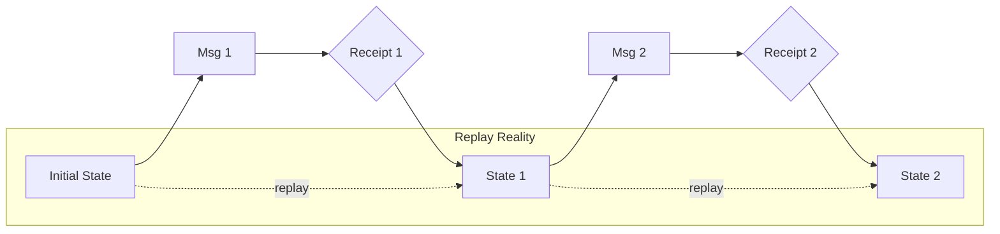

# TRUEX OTP RUNTIME TOPOLOGY REPORT

## 1. Local TypeScript OTP-Equivalence Semantics

The Truex runtime implements a local, single-process equivalent of the Open Telecom Platform (OTP) actor model. It is designed to provide process isolation, concurrent execution semantics, and fault tolerance for Hooks within a Node.js environment.

### Core Primitives
- **Process Boundaries:** Each Hook executes within an isolated logical process context. State is strictly localized; there is no shared memory between active Hook executions.
- **FIFO Mailboxes:** Hooks communicate strictly through asynchronous message passing. Messages are queued in a First-In-First-Out (FIFO) mailbox. 
- **Supervision Trees:** Supervisors monitor Hook execution. They maintain a defined "restart budget." When a Hook faults, the supervisor dictates whether to restart the Hook (resetting its state) or to escalate the failure, ensuring fault isolation.
- **Poison Message Quarantine:** Messages that repeatedly cause Hook crashes (exceeding the restart budget) are identified as "poison messages" and quarantined, preventing cascading failures.
- **Replay Semantics:** Because all state transitions are driven by discrete, logged messages (GraphDeltas), any process state can be perfectly reconstructed by replaying its mailbox history from a known initial state.

## 2. OTP-Shaped vs. BEAM-Grade

Truex is **OTP-shaped** because it adopts the architectural patterns of Erlang/OTP (isolated actors, message passing, supervision, crash-only design). 
However, it is **not BEAM-grade**:
- **Single Process:** It runs within a single Node.js V8 runtime. It does not provide the preemptive scheduling, per-process garbage collection, or multi-core parallelism inherent to the BEAM virtual machine.
- **No Network Clustering:** The current implementation lacks native distributed actor clustering across physical nodes. 

### Receipts-Before-Reality (Changing Runtime Law)
In standard OTP, a message is processed and state is mutated (reality), then optionally logged. In Truex, the runtime enforces **Receipts-Before-Reality**. A state transition (GraphDelta) is not considered valid or applied to the logical process until a cryptographic receipt (BLAKE3 hash) has been generated and appended to the unforgeable ledger. 
This inversion changes the fundamental law of the runtime: **Provability precedes Execution**. The immense overhead observed in the "Receipt-Backed OTP (Full Loop)" vs "Eval-Only" benchmarks is the physical cost of this runtime law.

## 3. Entropy Mismatch and Deterministic Context

### Entropy Mismatch
Truex agents and hooks operate in a deterministic simulation, yet they must interface with a high-entropy, non-deterministic external world (e.g., LLM APIs, network services). This creates an "entropy mismatch" at the system boundaries. Truex solves this via "Membrane" patterns, where non-deterministic external responses are captured, crystallized into deterministic GraphDeltas, and then fed into the OTP mailboxes.

### Replay Historical Coupling
Because processes are reconstructed via replay, any change to the *logic* of a Hook historically couples it to its past. If a Hook's code changes such that it interprets an old message differently, replay will diverge from the historical cryptographic receipt. Therefore, Hook logic must remain backwards-compatible with its historical mailbox schema, or state migrations must be explicitly defined.

### Deterministic Context Limits
The size of a Hook's context is limited by its mailbox history. While Node.js memory limits the active state, the deterministic constraint means every piece of context must be re-derivable. High-frequency messaging can bloat the mailbox, necessitating state snapshotting (compaction) to truncate the required replay history while preserving cryptographic provability.

## 4. Topology and Causal Diagrams

### OTP Topology Diagram

### Lifecycle State Machine

### Replay Causal Diagram

## 5. Evolution Toward Operational Field Physics

The Truex runtime is evolving beyond abstract actor models into **Operational Field Physics**. 
Standard compute models treat memory and execution as frictionless abstractions. By enforcing Receipts-Before-Reality, Truex introduces "mass" (cryptographic hashing cost) and "friction" (ledger append latency) to every state transition. 
The runtime is no longer just executing code; it is simulating a physical field where actions have undeniable, measurable consequences that cannot be bypassed. The strict boundaries, FIFO mailboxes, and immutable receipts act as the laws of physics for this digital space, guaranteeing that no state can exist without a mathematically proven causal lineage.

---

### Final Classification Block

*   **Target Scope:** OTP Runtime Topology and Concurrency Semantics
*   **Equivalence Level:** Local TypeScript Equivalent (Not BEAM)
*   **Runtime Law:** Receipts-Before-Reality
*   **Primary Constraint:** Replay Historical Coupling & Deterministic Context
*   **Architectural Trajectory:** Operational Field Physics
