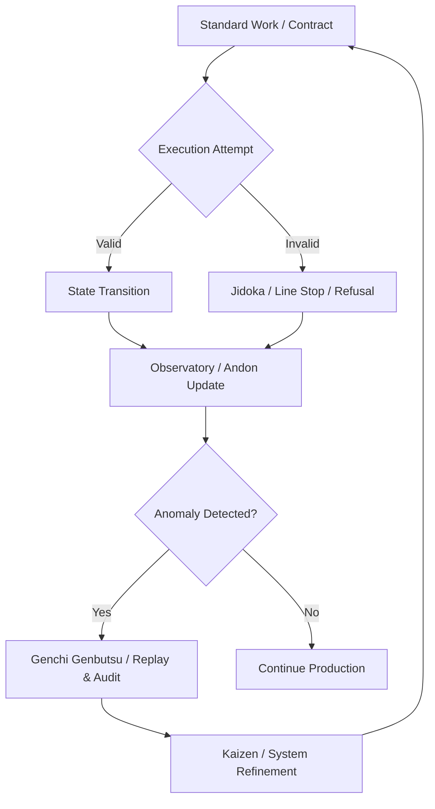

# Truex TPS Operational Control Law

## 1. Introduction

Truex is fundamentally a manufacturing system for application states, not a traditional SaaS runtime. In a SaaS runtime, errors are exceptions to be caught and logged; in a manufacturing system, errors are defects to be prevented, detected, and analyzed through rigorous operational control. Truex applies the principles of the Toyota Production System (TPS) to software execution, treating the runtime environment as an assembly line where state transitions are the products being manufactured. Observability in Truex is not merely a diagnostic tool; it is the production law that enforces quality at the source.

## 2. TPS Concepts Mapped to Truex

| TPS Concept | Definition | Truex Implementation |
| :--- | :--- | :--- |
| **Jidoka** | Automation with a human touch; stopping the process when a defect is detected. | Strict enforcement of invariants and preconditions; immediate halting of execution (refusal) when a violation occurs. |
| **Andon** | Visual management tool to signal a problem. | Truex Observatory; real-time telemetry, OCEL2 event logs, and trace alerts signaling operational anomalies. |
| **Poka-yoke** | Mistake-proofing; preventing errors before they occur. | Structural typing, compile-time checks, and runtime proxy membranes that make invalid state transitions impossible to express or execute. |
| **Heijunka** | Leveling the workload to reduce unevenness (Mura). | Rate limiting, queuing, and backpressure mechanisms within the Truex context to ensure predictable execution flow. |
| **Kaizen** | Continuous improvement. | Iterative refinement of invariants and control loops based on data collected from the Observatory and Replay tools. |
| **Muri** | Overburdening equipment or operators. | System resource exhaustion; mitigated by Truex's strict resource allocation and contract limits within virtualization. |
| **Mura** | Unevenness in production. | Hidden entropy and unpredictable state transitions; eliminated through deterministic execution and strict state machine adherence. |
| **Muda** | Waste. | Runtime waste (unnecessary computation) and telemetry waste (logging without actionable insight). |
| **Kanban** | Pull system to control flow. | Event-driven execution model where the completion of one state transition signals the readiness for the next, governed by OTP principles. |
| **Genchi Genbutsu** | "Go and see"; understanding the problem at the source. | Truex Replay; the ability to deterministically rewind and inspect the exact state and context of a failure. |
| **Standard Work** | Documented, repeatable processes. | Formal contracts, state transition definitions, and explicit semantic laws governing the system. |

## 3. Core Operational Mechanisms

### 3.1 Refusal as Line Stop (Jidoka)
In Truex, an error is not an exception to be swallowed; it is a defect on the assembly line. When an invariant is violated or a pre-condition fails, Truex triggers a "Refusal." This is equivalent to pulling the Andon cord and stopping the line (Jidoka). The system halts the specific execution context to prevent the defect from propagating downstream and corrupting the overall state.

### 3.2 Replay as Quality Audit (Genchi Genbutsu)
When a line stops, root cause analysis is required. Truex Replay provides the mechanism for *Genchi Genbutsu* ("go and see"). By capturing cryptographically verifiable event logs (OCEL2) and memory snapshots, Replay allows engineers to perform a deterministic quality audit, examining the exact sequence of events and state mutations that led to the defect, without relying on circumstantial evidence.

### 3.3 Observatory as Andon
The Truex Observatory serves as the system's Andon board. It provides real-time visibility into the health of the production line. By aggregating traces, metrics, and logs into a unified view, it signals deviations from standard work and alerts operators to potential issues (Mura or Muri) before they result in a line stop.

### 3.4 Supervisor as Containment Cell
When a failure occurs, the Truex Supervisor hierarchy acts as a containment cell. Drawing from Erlang/OTP principles, supervisors isolate the fault to the specific component or subsystem, preventing cascading failures. They manage the restart and recovery process, ensuring that the defect is contained and the rest of the manufacturing system continues to operate smoothly.

## 4. Operational Conservation Laws and Waste

Truex operates under strict conservation laws to eliminate waste (Muda).

*   **Operational Conservation Law:** The total state of the system is conserved; every state transition must be accounted for and cryptographically verifiable. No hidden state or "dark matter" is permitted.
*   **Runtime Waste:** Unnecessary computation, redundant state checks, or execution of paths that are guaranteed to fail. Truex minimizes runtime waste through strict contract enforcement early in the execution lifecycle.
*   **Telemetry Waste:** Emitting logs or traces that provide no actionable insight or are ignored. Truex focuses on high-signal observability, capturing only the data necessary to enforce production laws and audit quality.
*   **Hidden Entropy as Mura:** Unpredictability in execution flow or state mutation is a form of Mura (unevenness). Truex eliminates hidden entropy by enforcing deterministic state transitions and explicitly modeling all possible execution paths.

## 5. Mapping Tables and Control Loops

### 5.1 TPS <-> Gall <-> OTP Mapping

| TPS (Manufacturing) | Gall's Law (Complex Systems) | OTP (Concurrency & Fault Tolerance) | Truex Implementation |
| :--- | :--- | :--- | :--- |
| **Standard Work** | Simple working system | Processes and Behaviors (gen_server) | Explicit State Machines & Contracts |
| **Jidoka (Line Stop)** | Failure is inevitable; fail fast | Let it crash | Refusals and Invariant Violations |
| **Containment Cell** | Systems have boundaries | Supervision Trees | Proxies & Sandboxes |
| **Andon** | System behavior must be observable | Tracing and Telemetry | Truex Observatory (OCEL2) |
| **Genchi Genbutsu** | Complex systems evolve from simple ones | Post-mortem debugging | Deterministic Replay |

### 5.2 Runtime Control Loop



## 6. Conclusion: Truex as a Manufacturing System

Truex rejects the notion of software execution as a fluid, unstructured process. Instead, it treats execution as a rigorous manufacturing process. In this paradigm, observability is not an afterthought; it is the production law itself. Without observability, there is no quality control, and without quality control, the system cannot be trusted. By applying TPS principles, Truex ensures that every state transition is a high-quality product, manufactured according to strict semantic laws and verified through an unforgeable cryptographic supply chain.

## Final Classification Block

```yaml
classification: "TPS_OPERATIONAL_CONTROL_LAW"
system_type: "MANUFACTURING_RUNTIME"
core_principle: "OBSERVABILITY_AS_PRODUCTION_LAW"
status: "DEFINED"
```