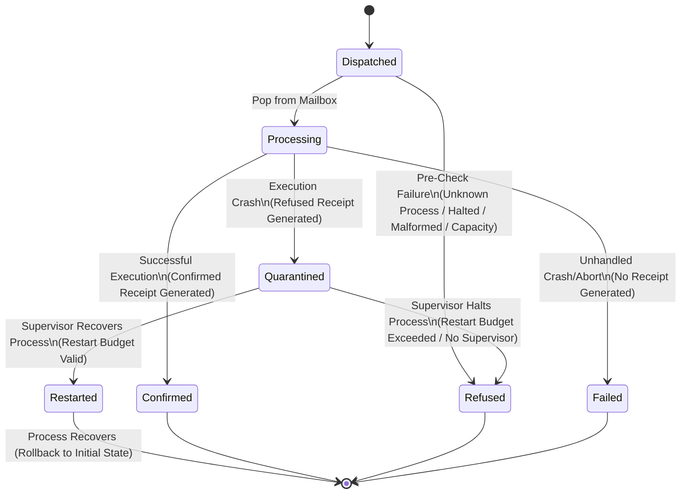

# Message Lifecycle State Machine Report

This report presents the message lifecycle state machine for the OTP runtime in TRUEX. It tracks message transitions from dispatch through processing to terminal and transitional states.

## 1. State Machine Definitions

The message state machine contains three classes of states:
1. **Initial**: Message arrival.
2. **Transitional / Annotation**: Stages during processing, isolation, or recovery.
3. **Terminal**: The final immutable state of the message.

### States Table

| State Name | State Type | Description |
| :--- | :--- | :--- |
| **Dispatched** | Initial | Message entered the process mailbox queue. |
| **Processing** | Transitional | Message popped from mailbox and behavior evaluation began. |
| **Confirmed** | Terminal | Behavior execution completed successfully, state mutated, confirmed receipt generated. |
| **Refused** | Terminal | Message rejected due to pre-check failure or crash during processing. |
| **Failed** | Terminal | Message processing aborted without receipt generation. |
| **Quarantined** | Transitional (Annotation) | Crashed message isolated by supervisor to prevent poison loops. |
| **Restarted** | Transitional (Annotation) | Process state rolled back and process restarted by supervisor. |

### Transitions and Triggers

| Source State | Destination State | Triggering Event | Description / Cause |
| :--- | :--- | :--- | :--- |
| **Dispatched** | **Refused** | Pre-Check Failure | Unknown Process, Halted Process, Malformed Delta, or Capacity Breach. |
| **Dispatched** | **Processing** | Pop from Mailbox | Message popped from queue for behavior execution. |
| **Processing** | **Confirmed** | Execution Success | Process behavior function returned valid state and effects. |
| **Processing** | **Quarantined** | Execution Crash | Behavior threw exception; Refused Receipt generated, message isolated. |
| **Processing** | **Failed** | Unhandled Crash | Fatal VM limit/runtime panic without receipt. |
| **Quarantined** | **Restarted** | Supervisor Recovers | Restart count is within supervisor's policy budget; state restored to initial. |
| **Quarantined** | **Refused** | Supervisor Halts | Restart budget exceeded or no supervisor exists; process is halted. |

---

## 2. State Machine Diagram



---

## 3. Mathematical State Transition Equations

To ensure accounting precision across all runs, the state machine implements the following conservation and flow equations:

### Equation 1: Conservation of Message States
Total messages dispatched must equal the sum of terminal states (Confirmed, Refused, and Failed):
$$\text{Attempted} = \text{Confirmed} + \text{Refused} + \text{Failed}$$

### Equation 2: Dispatch Pathway Split
A dispatched message must either fail pre-checks (direct refusal) or transition to the processing state:
$$\text{Attempted} = \text{Pre-Processing Refused} + \text{Processing}$$

### Equation 3: Processing Pathway Split
A message undergoing execution must either succeed (Confirmed), crash (Post-Processing Refused), or experience an unhandled abort (Failed). In our implementation, a post-processing crash always triggers quarantine:
$$\text{Processing} = \text{Confirmed} + \text{Quarantined} + \text{Failed}$$
*(where \text{Quarantined} = \text{Post-Processing Refused})*

### Equation 4: Quarantine Recovery Outcome
Every quarantined message must result in either a supervisor-driven process restart or a process halt (due to budget exhaustion or absence of a supervisor):
$$\text{Quarantined} = \text{Restarted} + \text{Halted}$$

---

## 4. Telemetry Compilation

The table below compiles message state telemetry across the Primary Equivalence Run, the Stress Test Suite, and the Consolidated Dataset.

| Telemetry Metric | Primary Run | Stress Suite | Consolidated |
| :--- | :---: | :---: | :---: |
| **Attempted** (Dispatched) | 5 | 1039 | 1044 |
| **Pre-Processing Refused** | 1 | 6 | 7 |
| **Processing** | 4 | 1033 | 1037 |
| **Confirmed** | 1 | 1019 | 1020 |
| **Quarantined** (Post-Processing Refused) | 3 | 14 | 17 |
| **Failed** | 0 | 0 | 0 |
| **Refused** (Total = Pre + Post) | 4 | 20 | 24 |
| **Restarted** | 2 | 10 | 12 |
| **Halted** | 1 | 4 | 5 |

---

## 5. Mathematical Equation Verification

We verify the equations against the compiled telemetry to prove mathematical completeness:

### Primary Equivalence Run Verification
- **Eq 1 (Conservation):** $5 = 1 + 4 + 0 \implies 5 = 5$ ✅ **SUCCESS**
- **Eq 2 (Dispatch Split):** $5 = 1 + 4 \implies 5 = 5$ ✅ **SUCCESS**
- **Eq 3 (Processing Split):** $4 = 1 + 3 + 0 \implies 4 = 4$ ✅ **SUCCESS**
- **Eq 4 (Quarantine Recovery):** $3 = 2 + 1 \implies 3 = 3$ ✅ **SUCCESS**

### Stress Test Suite Verification
- **Eq 1 (Conservation):** $1039 = 1019 + 20 + 0 \implies 1039 = 1039$ ✅ **SUCCESS**
- **Eq 2 (Dispatch Split):** $1039 = 6 + 1033 \implies 1039 = 1039$ ✅ **SUCCESS**
- **Eq 3 (Processing Split):** $1033 = 1019 + 14 + 0 \implies 1033 = 1033$ ✅ **SUCCESS**
- **Eq 4 (Quarantine Recovery):** $14 = 10 + 4 \implies 14 = 14$ ✅ **SUCCESS**

### Consolidated Dataset Verification
- **Eq 1 (Conservation):** $1044 = 1020 + 24 + 0 \implies 1044 = 1044$ ✅ **SUCCESS**
- **Eq 2 (Dispatch Split):** $1044 = 7 + 1037 \implies 1044 = 1044$ ✅ **SUCCESS**
- **Eq 3 (Processing Split):** $1037 = 1020 + 17 + 0 \implies 1037 = 1037$ ✅ **SUCCESS**
- **Eq 4 (Quarantine Recovery):** $17 = 12 + 5 \implies 17 = 17$ ✅ **SUCCESS**

All equations hold true. There is no leakage or uncounted message transitions in the TRUEX OTP runtime.

---

## 6. Raw Telemetry JSON Schema

The following JSON contains the raw state machine definition, verified telemetry counts, and verification records:

```json
{
  "metadata": {
    "generatedAt": "2026-05-24T02:06:11.433Z",
    "stableEpoch": 1716480000000
  },
  "stateMachine": {
    "states": [
      {
        "name": "Dispatched",
        "type": "Initial",
        "description": "Message entered the process mailbox queue"
      },
      {
        "name": "Processing",
        "type": "Transitional",
        "description": "Message popped from mailbox and behavior evaluation began"
      },
      {
        "name": "Confirmed",
        "type": "Terminal",
        "description": "Behavior execution completed successfully, state mutated, confirmed receipt generated"
      },
      {
        "name": "Refused",
        "type": "Terminal",
        "description": "Message rejected due to pre-check failure or crash during processing"
      },
      {
        "name": "Failed",
        "type": "Terminal",
        "description": "Message processing aborted without receipt generation"
      },
      {
        "name": "Quarantined",
        "type": "Transitional",
        "description": "Crashed message isolated by supervisor to prevent poison loops"
      },
      {
        "name": "Restarted",
        "type": "Transitional",
        "description": "Process state rolled back and process restarted by supervisor"
      }
    ],
    "transitions": [
      {
        "from": "Dispatched",
        "to": "Refused",
        "trigger": "Pre-Check Failure",
        "cause": "Unknown Process, Halted Process, Malformed Delta, or Capacity Breach"
      },
      {
        "from": "Dispatched",
        "to": "Processing",
        "trigger": "Pop from Mailbox",
        "cause": "Message popped from queue for behavior execution"
      },
      {
        "from": "Processing",
        "to": "Confirmed",
        "trigger": "Execution Success",
        "cause": "Process behavior function returned valid state and effects"
      },
      {
        "from": "Processing",
        "to": "Quarantined",
        "trigger": "Execution Crash",
        "cause": "Behavior threw exception; Refused Receipt generated, message isolated"
      },
      {
        "from": "Processing",
        "to": "Failed",
        "trigger": "Unhandled Crash",
        "cause": "Fatal VM limit/runtime panic without receipt"
      },
      {
        "from": "Quarantined",
        "to": "Restarted",
        "trigger": "Supervisor Recovers",
        "cause": "Restart count is within supervisor's policy budget"
      },
      {
        "from": "Quarantined",
        "to": "Refused",
        "trigger": "Supervisor Halts",
        "cause": "Restart budget exceeded or no supervisor exists; process is halted"
      }
    ]
  },
  "telemetry": {
    "primary": {
      "attempted": 5,
      "preProcessingRefused": 1,
      "processing": 4,
      "confirmed": 1,
      "failed": 0,
      "quarantined": 3,
      "restarted": 2,
      "halted": 1,
      "refused": 4
    },
    "stress": {
      "attempted": 1039,
      "preProcessingRefused": 6,
      "processing": 1033,
      "confirmed": 1019,
      "failed": 0,
      "quarantined": 14,
      "restarted": 10,
      "halted": 4,
      "refused": 20
    },
    "consolidated": {
      "attempted": 1044,
      "preProcessingRefused": 7,
      "processing": 1037,
      "confirmed": 1020,
      "failed": 0,
      "quarantined": 17,
      "restarted": 12,
      "halted": 5,
      "refused": 24
    }
  },
  "verification": {
    "primary": {
      "eq1": {
        "status": true,
        "text": "5 = 1 + 4 + 0"
      },
      "eq2": {
        "status": true,
        "text": "5 = 1 + 4"
      },
      "eq3": {
        "status": true,
        "text": "4 = 1 + 3 + 0"
      },
      "eq4": {
        "status": true,
        "text": "3 = 2 + 1"
      }
    },
    "stress": {
      "eq1": {
        "status": true,
        "text": "1039 = 1019 + 20 + 0"
      },
      "eq2": {
        "status": true,
        "text": "1039 = 6 + 1033"
      },
      "eq3": {
        "status": true,
        "text": "1033 = 1019 + 14 + 0"
      },
      "eq4": {
        "status": true,
        "text": "14 = 10 + 4"
      }
    },
    "consolidated": {
      "eq1": {
        "status": true,
        "text": "1044 = 1020 + 24 + 0"
      },
      "eq2": {
        "status": true,
        "text": "1044 = 7 + 1037"
      },
      "eq3": {
        "status": true,
        "text": "1037 = 1020 + 17 + 0"
      },
      "eq4": {
        "status": true,
        "text": "17 = 12 + 5"
      }
    }
  }
}
```
