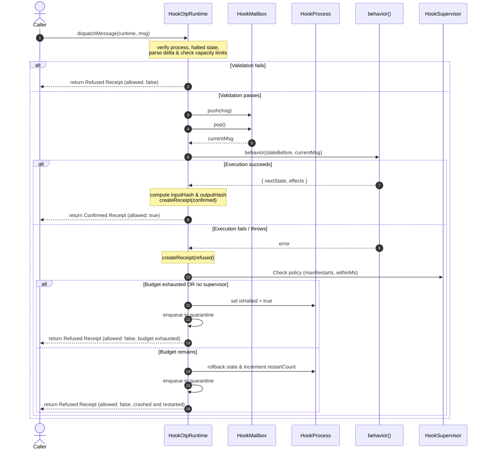
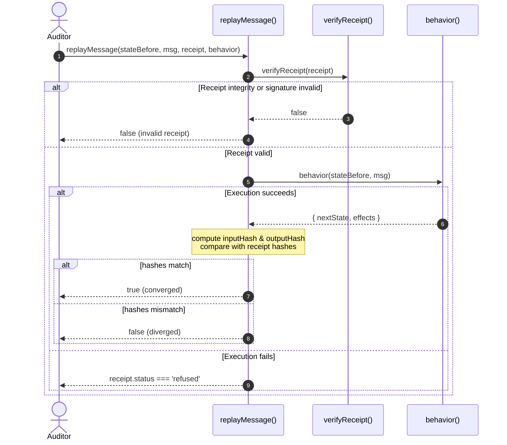

# Hook OTP Runtime Execution Flow Analysis

This report documents the detailed execution flow of the Hook One-Time-Process (OTP) runtime in the TRUEX engine. It details the pipeline stages from initial message dispatch to mailbox handling, behavior execution, receipt generation, fault containment, and replay verification.

---

## 1. Architectural Overview & Core Datatypes

The TRUEX OTP runtime provides a deterministic, state-isolated execution environment where processes (or Hooks) run behaviors sequentially, communicate via mailboxes, and record their computational transitions using cryptographic receipts. 

### Core Structs and Interfaces

#### HookMessage
Represents the incoming stimulus carrying a payload delta.
* **Defined in**: [hook-otp.gall.ts:L8-12](file:///Users/sac/truex/packages/truex-core/src/hook-otp.gall.ts#L8-L12)
```typescript
export interface HookMessage {
  id: string;
  targetProcessId: HookProcessId;
  delta: GraphDelta;
}
```

#### HookMailbox
Maintains a FIFO queue for a process's incoming messages.
* **Defined in**: [hook-otp.gall.ts:L14-20](file:///Users/sac/truex/packages/truex-core/src/hook-otp.gall.ts#L14-L20)
* **Factory Function**: `createHookMailbox` in [hook-otp.gall.ts:L22-31](file:///Users/sac/truex/packages/truex-core/src/hook-otp.gall.ts#L22-L31)
```typescript
export interface HookMailbox {
  queue: HookMessage[];
  push(msg: HookMessage): void;
  pop(): HookMessage | undefined;
  isEmpty(): boolean;
  size(): number;
}
```

#### HookProcess
Represents an isolated logical actor running a behavior function.
* **Defined in**: [hook-otp.gall.ts:L33-42](file:///Users/sac/truex/packages/truex-core/src/hook-otp.gall.ts#L33-L42)
* **Factory Function**: `createHookProcess` in [hook-otp.gall.ts:L44-58](file:///Users/sac/truex/packages/truex-core/src/hook-otp.gall.ts#L44-L58)
```typescript
export interface HookProcess {
  id: string;
  behavior: (state: any, msg: any) => { nextState: any; effects: any[] };
  state: any;
  mailbox: HookMailbox;
  restartCount: number;
  isHalted: boolean;
  supervisorId?: string;
  lastReceiptHash: string | null;
}
```

#### HookSupervisor
Supervises processes and manages restart policies to prevent infinite crash loops.
* **Defined in**: [hook-otp.gall.ts:L60-66](file:///Users/sac/truex/packages/truex-core/src/hook-otp.gall.ts#L60-L66)
```typescript
export interface HookSupervisor {
  id: string;
  policy: { maxRestarts: number; withinMs: number };
  processes: Map<string, HookProcess>;
  initialStates: Map<string, any>;
  restartTimestamps: Map<string, number[]>;
}
```

#### HookQuarantineRecord
Stores messages that caused runtime failures for offline analysis.
* **Defined in**: [hook-otp.gall.ts:L81-86](file:///Users/sac/truex/packages/truex-core/src/hook-otp.gall.ts#L81-L86)
```typescript
export interface HookQuarantineRecord {
  processId: HookProcessId;
  message: HookMessage;
  error: string;
  timestamp: number;
}
```

#### HookOtpRuntime
The central registry containing all supervisors, active/halted processes, quarantined messages, and metrics.
* **Defined in**: [hook-otp.gall.ts:L88-100](file:///Users/sac/truex/packages/truex-core/src/hook-otp.gall.ts#L88-L100)
```typescript
export interface HookOtpRuntime {
  processes: Map<HookProcessId, HookProcess>;
  supervisors: Map<string, HookSupervisor>;
  refusedReceipts: Receipt[];
  quarantine: HookQuarantineRecord[];
  metrics: {
    messagesDispatched: number;
    messagesProcessed: number;
    messagesConfirmed: number;
    messagesRefused: number;
    restarts: number;
  };
}
```

#### Receipt
The cryptographic log generated by the execution of a message, containing hashes of the input, the output, the previous transition, status (confirmed/refused), and optional post-quantum signatures.
* **Defined in**: [runtime-law.ts:L37-48](file:///Users/sac/truex/packages/truex-core/src/runtime-law.ts#L37-L48)
```typescript
export type Receipt = {
  id: string;
  eventId: string;
  deltaId: string;
  inputHash: string;
  outputHash: string;
  previousReceiptHash: string | null;
  status: 'confirmed' | 'refused';
  receiptHash: string;
  signature?: string;
  publicKey?: string;
};
```

---

## 2. Step-by-Step Message Execution Pipeline

The execution flow is governed by the `dispatchMessage` function defined in [hook-otp.gall.ts:L118-301](file:///Users/sac/truex/packages/truex-core/src/hook-otp.gall.ts#L118-L301). It executes the following stages:



### Stage 1: dispatchMessage & Initial Sanity Validation
When a message is dispatched to the runtime:
1. **Initialize Context**: A deterministic temporal context is generated for uuid and timestamp consistency:
   ```typescript
   const ctx = createDeterministicContext(1716480000000); // stable epoch
   runtime.metrics.messagesDispatched++;
   ```
   * **Source**: [hook-otp.gall.ts:L122-123](file:///Users/sac/truex/packages/truex-core/src/hook-otp.gall.ts#L122-L123)
2. **Process Existence & Halted State Check**: The process lookup is verified. If the process does not exist or is marked `isHalted`, execution is immediately refused and a `refused` receipt is returned.
   * **Source**: [hook-otp.gall.ts:L125-156](file:///Users/sac/truex/packages/truex-core/src/hook-otp.gall.ts#L125-L156)
3. **GraphDelta Syntax Parsing**: The message payload is validated against the GraphDelta schema structure. Any invalid format triggers immediate refusal.
   * **Source**: [hook-otp.gall.ts:L158-174](file:///Users/sac/truex/packages/truex-core/src/hook-otp.gall.ts#L158-L174)
   * **Underlying Logic**: `parseGraphDelta` in [runtime-law.ts:L83-102](file:///Users/sac/truex/packages/truex-core/src/runtime-law.ts#L83-L102) (validates that `adds` and `deletes` arrays contain valid RDF triple quads using `parseQuad`).
4. **Capacity Breach Assessment**: The total count of changes in the delta (adds + deletes) is checked against a hard limit of `100`.
   * **Source**: [hook-otp.gall.ts:L176-192](file:///Users/sac/truex/packages/truex-core/src/hook-otp.gall.ts#L176-L192)

### Stage 2: Mailbox Enqueuing
If all validation checks pass, the validated message is enqueued into the process's mailbox.
* **Source**: [hook-otp.gall.ts:L194-195](file:///Users/sac/truex/packages/truex-core/src/hook-otp.gall.ts#L194-L195)
```typescript
// 4. Queue the message in process mailbox
proc.mailbox.push(msg);
```

### Stage 3: Synchronous Mailbox Dequeuing
The message is popped immediately from the mailbox queue to be processed synchronously.
* **Source**: [hook-otp.gall.ts:L197-203](file:///Users/sac/truex/packages/truex-core/src/hook-otp.gall.ts#L197-L203)
```typescript
// 5. Process the message synchronously
const currentMsg = proc.mailbox.pop();
if (!currentMsg) {
  throw new Error("Mailbox empty immediately after pushing");
}
runtime.metrics.messagesProcessed++;
```

### Stage 4: Hook Execution
A clone of the process's current state is created to preserve the pre-transition state. The process behavior function is executed with this state and the popped message.
* **Source**: [hook-otp.gall.ts:L205-213](file:///Users/sac/truex/packages/truex-core/src/hook-otp.gall.ts#L205-L213)
```typescript
// Save state before processing for receipt input hash and possible supervisor rollback
const stateBefore = JSON.parse(JSON.stringify(proc.state));

// Execute behavior
const { nextState, effects } = proc.behavior(stateBefore, currentMsg);

// Verify nextState and effects are valid
proc.state = nextState;
```

### Stage 5: Receipt Emission
On successful execution, the runtime calculates deterministic Blake3 hashes for the input state and execution output, and emits a `confirmed` receipt.
* **Source**: [hook-otp.gall.ts:L215-230](file:///Users/sac/truex/packages/truex-core/src/hook-otp.gall.ts#L215-L230)
* **Receipt Construction**: `createReceipt` in [mutations.ts (receipt)](file:///Users/sac/truex/skills/receipt/mutations.ts#L52-L90)
```typescript
const inputHash = hash({ msg: currentMsg, stateBefore });
const outputHash = hash({ effects, stateAfter: nextState });

const confirmedReceipt = createReceipt(
  ctx,
  currentMsg.id,
  currentMsg.delta?.id || "unknown",
  inputHash,
  outputHash,
  proc.lastReceiptHash,
  "confirmed"
);

proc.lastReceiptHash = confirmedReceipt.receiptHash;
runtime.metrics.messagesConfirmed++;
return { allowed: true, receipt: confirmedReceipt };
```
> [!NOTE]
> By assigning `proc.lastReceiptHash = confirmedReceipt.receiptHash`, the process builds a cryptographically verifiable chain (receipt lineage) where each transition references the hash of the preceding one.

---

## 3. Failure Control, Rollbacks, and Supervision

If the behavior function throws during execution, the error is caught, and the fault containment protocol runs:

### Step 1: Refused Receipt Creation
A `refused` receipt is created using the current message as input hash and the error message hash as the output hash.
* **Source**: [hook-otp.gall.ts:L232-246](file:///Users/sac/truex/packages/truex-core/src/hook-otp.gall.ts#L232-L246)

### Step 2: Supervisor Check & Policy Application
The runtime checks if the process is registered under a supervisor.
* **Source**: [hook-otp.gall.ts:L248-254](file:///Users/sac/truex/packages/truex-core/src/hook-otp.gall.ts#L248-L254)

```typescript
const supervisor = proc.supervisorId ? runtime.supervisors.get(proc.supervisorId) : undefined;
const now = Date.now();

if (supervisor) {
  const history = supervisor.restartTimestamps.get(proc.id) || [];
  const recent = history.filter(t => now - t <= supervisor.policy.withinMs);
```

### Step 3: Halted State and Quarantine (Restart Budget Exhausted)
If the process has exceeded the supervisor's `maxRestarts` within the `withinMs` sliding window:
1. `proc.isHalted` is set to `true`.
2. The message is pushed to the quarantine repository.
3. The refused receipt is appended to the runtime refused registry.
* **Source**: [hook-otp.gall.ts:L255-266](file:///Users/sac/truex/packages/truex-core/src/hook-otp.gall.ts#L255-L266)

### Step 4: Restart & Rollback (Restart Budget Available)
If the budget has not been exhausted:
1. The restart timestamp is logged, and the restart counters are incremented.
2. **State Rollback**: The process's state is rolled back to its initial state stored in the supervisor's registry (`supervisor.initialStates.get(proc.id)`).
3. The crashing message is quarantined.
* **Source**: [hook-otp.gall.ts:L268-287](file:///Users/sac/truex/packages/truex-core/src/hook-otp.gall.ts#L268-L287)

### Step 5: Unsupervised Crash Containment
If no supervisor is registered for the process, it immediately halts and quarantines the message.
* **Source**: [hook-otp.gall.ts:L289-300](file:///Users/sac/truex/packages/truex-core/src/hook-otp.gall.ts#L289-L300)

---

## 4. Replay Verification

Replay verification enables an auditor to prove that a process converged deterministically given the same starting conditions.



The replay validation is implemented in the `replayMessage` function.
* **Source**: [hook-otp.gall.ts:L303-326](file:///Users/sac/truex/packages/truex-core/src/hook-otp.gall.ts#L303-L326)

```typescript
export function replayMessage(
  stateBefore: any,
  msg: HookMessage,
  receipt: Receipt,
  behavior: (state: any, msg: any) => { nextState: any; effects: any[] }
): boolean {
  try {
    if (!verifyReceipt(receipt)) {
      return false;
    }

    const { nextState, effects } = behavior(stateBefore, msg);

    const inputHash = hash({ msg, stateBefore });
    const outputHash = hash({ effects, stateAfter: nextState });

    if (receipt.inputHash !== inputHash) return false;
    if (receipt.outputHash !== outputHash) return false;

    return true;
  } catch {
    return receipt.status === 'refused';
  }
}
```

### Steps of Replay Auditing
1. **Self-Integrity & Signature Check**: `verifyReceipt(receipt)` recalculates the receipt's internal hash and validates post-quantum signatures if present.
   * **Underlying Logic**: `verifyReceipt` in [invariant.ts (receipt)](file:///Users/sac/truex/skills/receipt/invariant.ts#L10-L29)
2. **Behavior Simulation**: Runs the same behavior using the pristine `stateBefore` and `msg` inputs.
3. **Hash Comparison**:
   * Computes input hash of `{ msg, stateBefore }` and checks that it matches `receipt.inputHash`.
   * Computes output hash of `{ effects, stateAfter: nextState }` and checks that it matches `receipt.outputHash`.
4. **Refusal Convergence Verification**: If simulation throws, it is only considered a valid replay if the original receipt recorded the transaction as `refused`.

---

## 5. Summary of Key Files and Line Ranges

| Logical Step | Class / Function | File Path | Line Range |
| :--- | :--- | :--- | :--- |
| **Data Types** | `HookMessage`, `HookMailbox`, `HookProcess`, `HookSupervisor`, `HookQuarantineRecord`, `HookOtpRuntime` | [hook-otp.gall.ts](file:///Users/sac/truex/packages/truex-core/src/hook-otp.gall.ts) | [L8-L100](file:///Users/sac/truex/packages/truex-core/src/hook-otp.gall.ts#L8-L100) |
| **Data Types** | `Receipt`, `GraphDelta`, `Quad` | [runtime-law.ts](file:///Users/sac/truex/packages/truex-core/src/runtime-law.ts) | [L2-L53](file:///Users/sac/truex/packages/truex-core/src/runtime-law.ts#L2-L53) |
| **Step 1: Sanity checks** | `dispatchMessage` | [hook-otp.gall.ts](file:///Users/sac/truex/packages/truex-core/src/hook-otp.gall.ts) | [L118-L192](file:///Users/sac/truex/packages/truex-core/src/hook-otp.gall.ts#L118-L192) |
| **Step 2: Mailbox push** | `mailbox.push` | [hook-otp.gall.ts](file:///Users/sac/truex/packages/truex-core/src/hook-otp.gall.ts) | [L194-L195](file:///Users/sac/truex/packages/truex-core/src/hook-otp.gall.ts#L194-L195) |
| **Step 3: Mailbox pop** | `mailbox.pop` | [hook-otp.gall.ts](file:///Users/sac/truex/packages/truex-core/src/hook-otp.gall.ts) | [L197-L203](file:///Users/sac/truex/packages/truex-core/src/hook-otp.gall.ts#L197-L203) |
| **Step 4: Hook Execution** | `proc.behavior` | [hook-otp.gall.ts](file:///Users/sac/truex/packages/truex-core/src/hook-otp.gall.ts) | [L205-L213](file:///Users/sac/truex/packages/truex-core/src/hook-otp.gall.ts#L205-L213) |
| **Step 5: Receipt Emission** | `createReceipt` | [mutations.ts (receipt)](file:///Users/sac/truex/skills/receipt/mutations.ts) | [L52-L90](file:///Users/sac/truex/skills/receipt/mutations.ts#L52-L90) |
| **Step 6: Fault Recovery** | Supervision & quarantine handling | [hook-otp.gall.ts](file:///Users/sac/truex/packages/truex-core/src/hook-otp.gall.ts) | [L232-L300](file:///Users/sac/truex/packages/truex-core/src/hook-otp.gall.ts#L232-L300) |
| **Step 7: Replay Audit** | `replayMessage` | [hook-otp.gall.ts](file:///Users/sac/truex/packages/truex-core/src/hook-otp.gall.ts) | [L303-L326](file:///Users/sac/truex/packages/truex-core/src/hook-otp.gall.ts#L303-L326) |
| **Receipt Verification** | `verifyReceipt` | [invariant.ts (receipt)](file:///Users/sac/truex/skills/receipt/invariant.ts) | [L10-L29](file:///Users/sac/truex/skills/receipt/invariant.ts#L10-L29) |
| **JSON Stabilization** | `stableJson` | [mutations.ts (hash)](file:///Users/sac/truex/skills/hash/mutations.ts) | [L10-L35](file:///Users/sac/truex/skills/hash/mutations.ts#L10-L35) |
| **Blake3 Hashing** | `hash` | [mutations.ts (hash)](file:///Users/sac/truex/skills/hash/mutations.ts) | [L41-L48](file:///Users/sac/truex/skills/hash/mutations.ts#L41-L48) |
