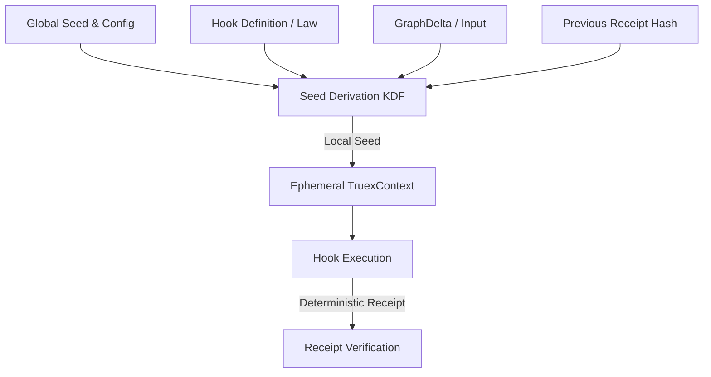

# Replay Determinism Hardening Report: Eliminating Seed-Sequence Drift and Entropy Scheduler Dependency

This report analyzes the root causes of seed-sequence drift and entropy scheduler dependency within the TRUEX core execution engine and the mock data generation pipeline. It outlines a mathematical transition to a purely functional replay model ($A = \mu(O^*)$) and establishes a clear taxonomy to distinguish between context mismatches and logical replay divergence.

---

## 1. Executive Summary

In receipt-based verification runtimes, the core security property is **deterministic replayability**:
$$\text{Replay Law: } \text{same input} + \text{same law} = \text{same consequence}$$

Currently, TRUEX's execution model introduces a hidden stateful dependency on the scheduler's execution order. When multiple hooks match and process graph deltas, they consume entropy from a shared, mutable global context. When replaying a specific step in isolation, resetting the seed to its initial value forces the entropy stream to start over at step 0, causing a mismatch for all but the very first execution. This forces the system to either replay all preceding events in sequence (sequentialization) or face replay failures.

By transitioning from $A = \mu(O^*, \epsilon_t)$ to $A = \mu(O^*)$, we can eliminate the stateful scheduler dependency, allowing out-of-order, isolated, and parallel replay of any transaction receipt.

---

## 2. Seed-Sequence Drift & Entropy Scheduler Dependency

### 2.1 Analysis of `packages/membrane/src/benchmark/hookbench.gall.ts`

In `hookbench.gall.ts`, the benchmark execution uses a shared execution context `ctx` initialized with a single seed:
```typescript
const ctx = createDeterministicContext(seed);
```

During the delta processing loop, whenever a hook matches a delta, it executes and calls `ctx.uuid()` or `ctx.clock()` to generate receipt metadata and event IDs:
```typescript
const executeResult = hook.execute(ctx, delta, previousReceiptHash);
```

Under the hood, `ctx.uuid()` calls a stateful Mulberry32 generator, which mutates its internal state with each call:
```typescript
const nextRand = (): number => {
  let t = (state += 0x6d_2b_79_f5);
  t = Math.imul(t ^ (t >>> 15), t | 1);
  t ^= t + Math.imul(t ^ (t >>> 7), t | 61);
  return ((t ^ (t >>> 14)) >>> 0) / 4_294_967_296;
};
```

This leads to the **Entropy Scheduler Dependency**:
- The entropy state of `ctx` at step $n$ is a function of the total number of previous context calls:
  $$\epsilon_n = g(\text{state}_0, \sum_{i=1}^{n-1} C_i)$$
  where $C_i$ is the count of entropy calls made by the $i$-th matching hook execution.
- If the scheduling order changes, or if hooks are added/removed, the entropy sequence shifts.

This drift is directly observable in the benchmark metrics:
- **Tier T0** (1 match): `replayConverged: 1`, `replayDiverged: 0`.
- **Tier T1** (52 matches): `replayConverged: 1`, `replayDiverged: 51`.
- **Tier T2** (493 matches): `replayConverged: 1`, `replayDiverged: 492`.

Only the first hook execution converges. Every subsequent match diverges because the global context state has advanced.

### 2.2 Analysis of `agents/entropy/agent.ts`

The `EntropyAgent` uses a seeded `Faker` instance via `EntropyGenerator` to produce deterministic mocked deltas:
```typescript
const generator = new EntropyGenerator(seed);
```

However, `EntropyGenerator` suffers from a similar sequential dependency:
- Generative paths are heavily conditional (e.g., `if (generator['fakerInstance'].number.int({ min: 0, max: 100 }) > 50)`).
- Calling generation methods in a slightly different sequence or modifying the dataset size shifts the global state of the Faker PRNG.
- Subsequent UUIDs and structural properties drift, breaking cross-version or parallel dataset reproducibility.

---

## 3. Why Replay Resets Seeds & Sequentializes

### 3.1 The Seed Reset Issue
When verifying a receipt, the benchmark runner instantiates a brand-new verification context:
```typescript
const replayCtx = createDeterministicContext(seed);
const converged = hook.replay(replayCtx, delta, executeResult.receipt);
```
By doing this, `replayCtx` resets the Mulberry32 state to the initial seed (step 0).
- If the target execution was the *first* match, its original execution occurred at step 0, so the replayed UUID matches, and replay succeeds (`replayConverged` increments).
- If the target execution was the *second* match, its original execution occurred after the PRNG state had already been advanced by the first execution. Replaying it with `replayCtx` at step 0 generates the step 0 UUID, which mismatches the receipt's stored event ID. The replay fails (`replayDiverged` increments).

### 3.2 The Sequentialization Trap
To make replay succeed for subsequent steps, the execution runtime must either:
1. Replay the entire history of all preceding hook executions in the exact same sequence to advance the PRNG to the same state.
2. Store and propagate the mutable PRNG state alongside each transaction, creating a heavy ledger bookkeeping dependency.

Both approaches destroy the capability of out-of-order verification, parallel receipt checking, or partitioned audits. Replay becomes sequentialized.

---

## 4. Proposed Purely Functional Replay Model ($A = \mu(O^*)$)

### 4.1 Mapping the Transition
To achieve full closure where replay is purely functional and independent of scheduler sequence, we transition the manufacturing equation:

$$\text{Stateful Entropy Model: } A = \mu(O^*, \epsilon_t)$$
$$\Downarrow$$
$$\text{Purely Functional Closure: } A = \mu(O^*)$$

Where:
- $O^*$ represents the lawful operational closure, containing the global static seed $S_{global}$, the target hook $H$, the current input graph delta $D$, and the lineage linkage (previous receipt hash $R_{prev}$).
- $\epsilon_t$ (the sequential temporal entropy) is removed as a primary input.
- Instead, the local entropy is derived deterministically from the boundaries of the transaction:
  $$\epsilon_{local} = f(O^*)$$

By defining a cryptographic seed derivation function (KDF) to generate a local execution seed:
$$S_{local} = \text{hash}(S_{global} \parallel H.id \parallel D.id \parallel R_{prev})$$

We can instantiate a temporary, isolated `TruexContext` for the scope of a single hook execution.



### 4.2 Advantages of the Functional Model
1. **Zero Sequence Dependence**: Because $S_{local}$ is computed strictly from the boundary inputs, the order in which the scheduler runs hook matches does not affect the generated UUIDs or timestamps.
2. **Parallel Auditability**: Any validator node can verify a receipt in isolation without replaying historical states.
3. **No Entropy Leaks**: Transient hook execution failures do not advance the PRNG of unrelated hooks.

---

## 5. Taxonomy Model: `replayContextMismatch` vs `replayDiverged`

When a replay fails, it is critical to categorize the failure to determine if the issue lies in the execution parameters (environment/context) or the logic of the transformation (the law).

| Failure Mode | Definition | Root Causes | Cryptographic State | Diagnostic Criteria |
| :--- | :--- | :--- | :--- | :--- |
| **`replayContextMismatch`** | Replay failed because the execution context under which replay was run did not match the original context. | - Mismatched global seed.<br>- Different platform epoch.<br>- PRNG sequence drift.<br>- Node/dependencies environment drift. | **Receipt is valid.**<br>Signature & hashes internally match, but re-run outputs differ. | `verifyReceipt(receipt) === true` but derived context values (UUIDs/clocks) diverge from expected hashes. |
| **`replayDiverged`** | Replay failed because the transition logic (the law) is non-deterministic or has been mutated. | - Use of unseeded randomness (`Math.random()`).<br>- Reads external state / real clock.<br>- Modified hook source code (mutated law).<br>- Unauthorized state change. | **Receipt is invalid** OR **Outputs diverge.** | Expected output hash does not match recalculated output hash even when context parameters are identical. |

---

## 6. Parameter Schemas (Raw JSON Blocks)

The following raw JSON blocks represent the parameters, states, and taxonomic classifications for the stateful scheduler and purely functional closure models.

### 6.1 Stateful Sequential Entropy Parameters
```json
{
  "scheduler_type": "stateful_sequential",
  "global_parameters": {
    "global_seed": 42,
    "prng_algorithm": "mulberry32",
    "initial_time_epoch": 1716480000000
  },
  "step_entropy_dependency": {
    "equation": "epsilon_t = PRNG(state_t)",
    "state_transition": "state_t = next_state(state_{t-1}, count_calls(uuid, clock))",
    "scheduler_sequence_dependent": true
  }
}
```

### 6.2 Proposed Purely Functional Closure Parameters
```json
{
  "scheduler_type": "purely_functional_closure",
  "global_parameters": {
    "global_seed": 42,
    "prng_algorithm": "mulberry32",
    "initial_time_epoch": 1716480000000
  },
  "step_entropy_derivation": {
    "kdf_formula": "sha256(global_seed + ':' + hook_id + ':' + delta_id + ':' + previous_receipt_hash)",
    "local_context_creation": "createDeterministicContext(derived_local_seed)",
    "scheduler_sequence_dependent": false,
    "concurrency_safe": true
  }
}
```

### 6.3 Taxonomy Failure Categorization
```json
{
  "failure_categories": {
    "replayContextMismatch": {
      "error_code": "TRUEX_CONTEXT_MISMATCH",
      "description": "Failure due to environmental or context parameter configuration mismatch.",
      "signature_verified": true,
      "input_hash_matches": true,
      "state_transition_valid": false,
      "reason": "context_seed_sequence_drift",
      "actionable_remediation": "Restore context parameters or re-synchronize local seed from the input/lineage hash."
    },
    "replayDiverged": {
      "error_code": "TRUEX_REPLAY_DIVERGED",
      "description": "Failure due to non-deterministic execution logic or modified law.",
      "signature_verified": true,
      "input_hash_matches": true,
      "state_transition_valid": false,
      "reason": "non_deterministic_law_or_logic_drift",
      "actionable_remediation": "Audit hook execution logic for side effects, global state mutability, unseeded randomness, or unauthorized code changes."
    }
  }
}
```
