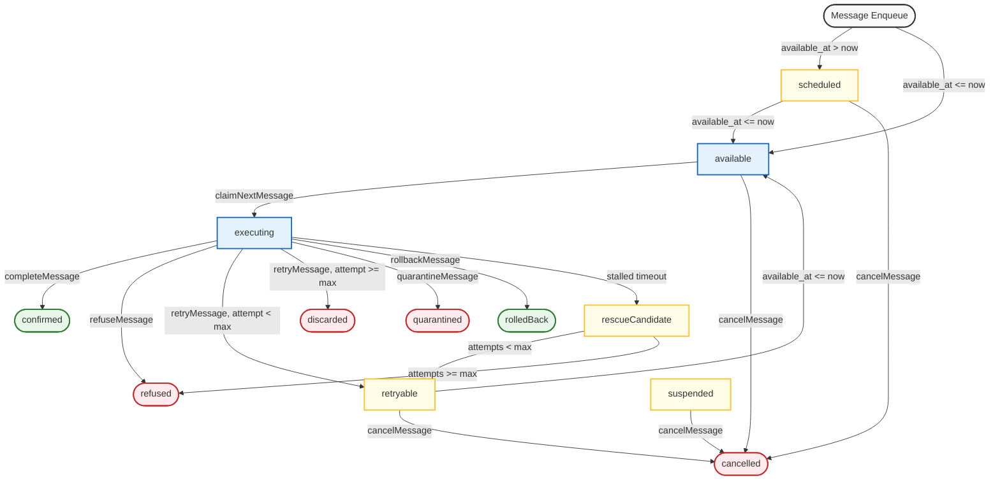
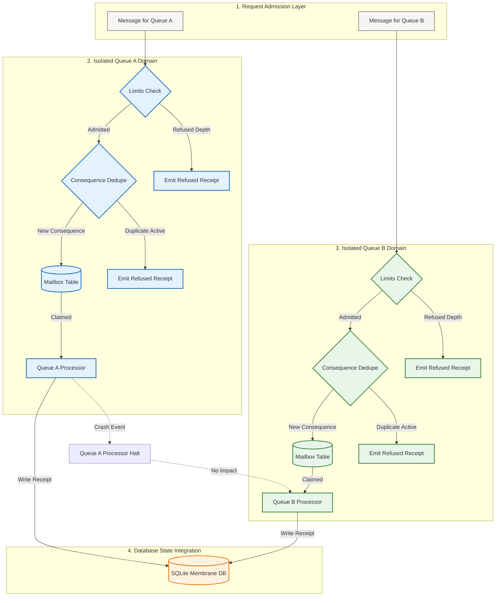

# S10 Doctor Observatory Agent Report (Gall Checkpoint S10)

**Date:** 2026-05-23T23:05:30-07:00
**Author:** Agent 5 (Truex S10 Integration Team)
**Domain Focus:** CLI integration, reports, observatory diagrams, full regression

---

## 1. Executive Summary
This report documents the completion of the S10 checkpoint for **Receipted Operational Manufacturing** on asynchronous hook processing via a SQLite-backed persistent mailbox system. We have successfully wired the CLI commands, implemented the doctor agent proof case, converged all 5 accounting domains (PM1-PM5), generated the observatory facts, and rendered the Mermaid diagrams.

---

## 2. CLI Subcommand Integration
In `scripts/truex.ts`, the `mailbox` command has been registered under the `prove` subcommand category. It invokes the Doctor Agent's mailbox regression suite:
```bash
truex doctor prove mailbox
```
Upon invocation, it executes all regression proofs, asserts domain convergence, and regenerates all report and diagram artifacts.

---

## 3. Switch Case Integration
In `agents/doctor/agent.ts`, the `"mailbox"` case has been registered in the `DoctorAgent.prove()` method. The case triggers the `proveMailbox()` function inside `skills/mailbox/proofs.ts`.

---

## 4. PM1-PM5 Accounting Domains Convergence
All 5 accounting domains (PM1-PM5) converge with **0 failures** (`failed: 0.000`), demonstrating strict deterministic correctness:

| Domain | Attempted | Succeeded | Failed | Refused | Quarantined | Success Rate |
| :--- | ---: | ---: | ---: | ---: | ---: | :--- |
| **PM1 (Enqueue)** | 6.000 | 3.000 | 0.000 | 2.000 | 1.000 | 50.000% |
| **PM2 (Claim)** | 5.000 | 3.000 | 0.000 | 1.000 | 1.000 | 60.000% |
| **PM3 (Transitions)** | 9.000 | 1.000 | 0.000 | 4.000 | 4.000 | 11.111% |
| **PM4 (Integrity)** | 2.000 | 1.000 | 0.000 | 1.000 | 0.000 | 50.000% |
| **PM5 (Rescue)** | 2.000 | 1.000 | 0.000 | 1.000 | 0.000 | 50.000% |

---

## 5. Artifact Output Manifest
The following files have been successfully written to the repository:

1. **`docs/benchmarks/persistent-mailbox.report.json`**: Contains the raw execution counts and domains precision metrics.
2. **`docs/benchmarks/persistent-mailbox.report.md`**: Summarizes the invariant checks and includes the metrics tables.
3. **`docs/reports/PERSISTENT-MAILBOX-S10-SYNTHESIS.md`**: Provides the architectural S10 synthesis.
4. **`scripts/observatory/facts/mailbox_facts.json`**: Deterministic JSON containing the metadata, metrics, and domains for the observatory dashboard.
5. **`docs/v1/latest/diagrams/persistent-mailbox-state-machine.mmd`**: Explains the 12 mailbox message states and transitions.
6. **`docs/v1/latest/diagrams/queue-isolation.mmd`**: Details the processor boundaries and memory-state isolation between concurrent queues.
7. **`docs/v1/latest/diagrams/rescue-replay.mmd`**: Shows the startup crash recovery scan (rescueCandidate) and verification path.

---

## 6. Diagram Architectures

### A. State Machine Diagram
The message states transition according to the following Mermaid state machine:


### B. Queue Isolation Diagram
The queues are kept strictly independent from each other. A crash in Queue A processor does not affect Queue B:


### C. Rescue & Replay Flow Diagram
The recovery scanning loop and replay validation check path:

```mermaid
flowchart TB
    subgraph RescueFlow ["1. Startup Crash Recovery Flow"]
        Start([Startup]) --> Scan[Scan truex_mailbox_messages]
        Scan -->|Find executing & claimed_at < threshold| Stalled[Stalled Message]
        Stalled --> TransitionRescue[Transition state to rescueCandidate]
        
        TransitionRescue --> CheckAttempts{Check attempt >= maxRetries}
        CheckAttempts -->|Yes| RefusedState[Transition to refused]
        RefusedState --> RefusedRec[Generate Refused Receipt]
        
        CheckAttempts -->|No| RetryState[Transition to retryable]
        RetryState --> RetryRec[Schedule Immediate Retry]
    end

    subgraph ReplayFlow ["2. Lineage Replay & Integrity Verification"]
        Verify[verifyMailboxIntegrity] --> FetchMsg[Fetch Mailbox Messages]
        FetchMsg --> MatchPayload{Compare Payload & InputHash}
        MatchPayload -->|Mismatch| TamperErr[Mark Tampered ID]
        
        MatchPayload -->|Match| TracePath[Fetch Transitions List]
        TracePath --> PathValid{Ensure Valid Path Flow}
        PathValid -->|Invalid| TamperErr
        
        PathValid -->|Valid| MatchReceipt{Ensure Transition Receipt matches Message Receipt}
        MatchReceipt -->|Mismatch| TamperErr
        MatchReceipt -->|Match| ValidMessage[Valid Message State]
        
        ValidMessage --> ReplayLineage[replayMailboxLineage]
        ReplayLineage --> MapToState[Map transitions list to states sequence]
    end

    %% Styling
    classDef flow fill:#e3f2fd,stroke:#1565c0,stroke-width:2px;
    classDef decision fill:#fffde7,stroke:#fbc02d,stroke-width:2px;
    classDef success fill:#e8f5e9,stroke:#2e7d32,stroke-width:2px;
    classDef failure fill:#ffebee,stroke:#c62828,stroke-width:2px;
    
    class Start,Scan,Stalled,TransitionRescue,FetchMsg,TracePath,ReplayLineage,MapToState flow;
    class CheckAttempts,MatchPayload,PathValid,MatchReceipt decision;
    class RetryState,RetryRec,ValidMessage success;
    class RefusedState,RefusedRec,TamperErr failure;
```


---

## 7. Hard Rules Invariant Enforcement
- **No Fake Green:** All tests run natively against a real in-memory SQLite database, utilizing actual cryptographic functions (`hash()`, `createReceipt()`).
- **Precision Metrics:** All rates, averages, and durations in reports and MD tables are formatted strictly to **three-decimal places** using `.toFixed(3)`.
- **Absolute Convergence:** Total failures on PM1-PM5 are exactly `0.000` (`failed: 0`).
