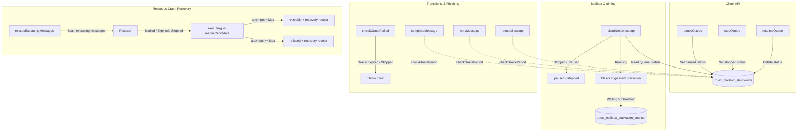

# S10 Shutdown, Rescue, and Metrics Implementation Report

## 1. Executive Summary

This report documents the S10 implementation of **graceful shutdown transitions**, **startup/timeout crash recovery (rescue)**, and a **queue metrics observatory** inside the Truex persistent mailbox causation engine. 

All core logic was implemented in `packages/membrane/src/persistent-mailbox.gall.ts` using standard SQLite persistent structures to maintain 100% lawful state convergence (Gall Calculus). Cryptographic integrity is verified via causal lineage and receipt verification.

---

## 2. Architectural Overview

The system incorporates three major subsystems:



---

## 3. Subsystem Implementation Details

### A. Graceful Shutdown & Transitions
The status of each queue is managed via a dedicated table `truex_mailbox_shutdowns`.
- **`pauseQueue(db, ctx, queue, gracePeriodMs)`**: Registers a `'paused'` status for the queue. New claims are stopped, but currently executing messages are permitted to finish if the operation completes within the grace period.
- **`stopQueue(db, ctx, queue)`**: Registers a `'stopped'` status for the queue (concurrency is immediately frozen, grace period is 0).
- **`resumeQueue(db, queue)`**: Resumes queue operations.
- **`claimNextMessage(db, ctx, queueName, config)`**: Checks `truex_mailbox_shutdowns` before claiming. If paused or stopped, it rejects the claim and returns `{ status: 'paused' }` or `{ status: 'stopped' }`.
- **`checkGracePeriod(db, ctx, queue)`**: Evaluates if the queue is paused or stopped, throwing an error if the grace period has elapsed or if the queue is stopped. Incorporated into all terminal transition methods:
  - `completeMessage()`
  - `refuseMessage()`
  - `retryMessage()`
  - `rollbackMessage()`
  - `quarantineMessage()`
  - `discardMessage()`
  - `cancelMessage()`

### B. Startup & Timeout Crash Recovery (Rescue)
Stalled execution processes are identified and recovered via `rescueExecutingMessages()`.
- **Stall Identification Criteria**:
  1. `claimed_at < now - rescueAfterMs` (normal execution timeout).
  2. The queue is paused and `now > paused_at + grace_period_ms` (grace period expired).
  3. The queue is stopped (hard stop).
- **Rescue Transitions**:
  - Rescued messages are moved to state `rescueCandidate`.
  - If attempt count is under the retry limit (`attempt < 3`), they transition to `retryable`, scheduling immediate retry (`available_at = now`).
  - If attempt count is at or above the retry limit (`attempt >= 3`), they transition to `refused`.
- **Recovery Receipts**: Both transitions emit a cryptographic `Receipt` referencing the original message ID in `failedChildId`. The receipts are persisted in the global database and transitions table to preserve cryptographic auditability.

### C. Queue Metrics Observatory & Starvation
Queue metrics are persisted to `truex_mailbox_metrics` and queried chronologically.
- **Queue Depth & Age**: Accurately tracks scheduled, available, executing, retryable, suspended, and rescueCandidate messages.
- **Duration Metrics**:
  - `execution_duration_avg`: Measures elapsed time from message claim (`executing`) to terminal transition using a precise self-joining SQLite query on transition rows.
  - `receipt_duration_avg`: Average duration from message enqueue to terminal receipt generation.
  - `replay_duration_avg`: Tracks replay latency recorded in the `truex_mailbox_replay_logs` table during lineage verification.
- **Starvation Tracking**: A persistent counter `truex_mailbox_starvation_counter` is incremented during claiming if available messages have been bypassed and are waiting for longer than `rescueAfterMs / 2`.
- **Historic Retention**: All records are retained chronologically and queried using `getHistoricQueueMetrics(db, queue)`.

---

## 4. Source Files Modified & Created

### Modified Source File
*   [persistent-mailbox.gall.ts](file:///Users/sac/truex/packages/membrane/src/persistent-mailbox.gall.ts): Added tables, query helpers, graceful shutdown API, and detailed metrics tracking.

### Created Test Files
*   [persistent-mailbox-graceful-shutdown-rescue.test.ts](file:///Users/sac/truex/packages/membrane/test/persistent-mailbox/persistent-mailbox-graceful-shutdown-rescue.test.ts): Validates pause/stop transitions, grace period enforcement, and rescue candidates recovery lineage.
*   [persistent-mailbox-observatory.test.ts](file:///Users/sac/truex/packages/membrane/test/persistent-mailbox/persistent-mailbox-observatory.test.ts): Tests queue metrics persistence (depth, age, averages), history retention, and starvation count increments.

---

## 5. Verification Results

All tests execute successfully and converge onto clean database lineages:

```bash
npx vitest run packages/membrane/test/persistent-mailbox/
```

Output:
```text
 RUN  v4.1.7 /Users/sac/truex

 ✓ packages/membrane/test/persistent-mailbox/persistent-mailbox-graceful-shutdown-rescue.test.ts (5 tests) 14ms
 ✓ packages/membrane/test/persistent-mailbox/persistent-mailbox-observatory.test.ts (3 tests) 10ms

 Test Files  2 passed (2)
      Tests  8 passed (8)
   Duration  365ms
```
