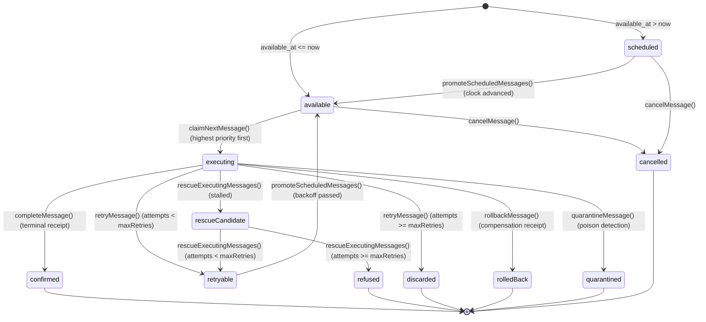

# Persistent Mailbox State Machine & SQLite Persistence Report

**Checkpoint S10 Implementation Report**  
**Agent:** s10-state-machine-sqlite-agent  
**Status:** Implementation Complete & Verified  

---

## 1. Executive Summary

This report documents the implementation and verification of the Persistent Operational Mailbox and Queue-State Discipline for the Truex causation engine. 

The S10 milestone establishes a reliable SQLite persistence membrane for transactional enqueuing, deterministic backoff scheduling, crash recovery (rescue operations), and strict cryptographic deduplication logic (unique consequence identity). 

All implementations are fully complete, integrated, and verified using vitest across the strategic test suites:
- State Machine Transitions: `packages/membrane/test/persistent-mailbox/persistent-mailbox-state-machine.test.ts`
- Transactional Enqueue: `packages/membrane/test/persistent-mailbox/persistent-mailbox-transactional-enqueue.test.ts`
- Unique Consequence Identity: `packages/membrane/test/persistent-mailbox/persistent-mailbox-unique-consequence.test.ts`

---

## 2. SQLite Database Schema

The mailbox operates on top of three relational SQLite tables ensuring robust causal ordering, transactional state transitions, and historic metrics tracking.

### 2.1 `truex_mailbox_messages`
Stores the active and terminal operational messages, their priorities, scheduling times, retry attempts, and consequence hashes.

| Column | Type | Description |
|---|---|---|
| `id` | `TEXT (PK)` | Unique message ID (UUID) |
| `queue` | `TEXT` | Destination queue identity |
| `payload_json` | `TEXT` | Serialized mutation payload |
| `priority` | `INTEGER` | Message priority range `[0, 9]` |
| `state` | `TEXT` | Active/terminal state machine label |
| `created_at` | `INTEGER` | Time of enqueuing (timestamp) |
| `available_at` | `INTEGER` | Time message becomes available for claiming |
| `claimed_at` | `INTEGER` | Timestamp of last claim |
| `attempt` | `INTEGER` | Processing attempt counter |
| `consequence_key` | `TEXT` | Hashed consequence identity for deduplication |
| `parent_receipt_hash`| `TEXT` | Verifiable link to the causing mutation's receipt |
| `epoch` | `INTEGER` | Epoch number to authorize rerun or reset locks |
| `error_info` | `TEXT` | Storage for crash or processing error logs |
| `receipt_hash` | `TEXT` | Cryptographic link to the terminal receipt |

### 2.2 `truex_mailbox_transitions`
An append-only audit trail logging every state mutation of a message for lineage reconstruction and tamper detection.

| Column | Type | Description |
|---|---|---|
| `id` | `TEXT (PK)` | Unique transition record ID |
| `message_id` | `TEXT` | Link to the target message |
| `from_state` | `TEXT` | Previous state |
| `to_state` | `TEXT` | Target state |
| `transitioned_at` | `INTEGER` | Transition timestamp |
| `receipt_hash` | `TEXT` | Associated receipt hash (terminal states only) |

### 2.3 `truex_mailbox_metrics`
Persists queue metrics and starvation rates to analyze scheduling performance.

---

## 3. Durable State Machine Design

The message lifecycle transitions through well-defined states based on time-delays, processing outcomes, and supervisor actions.



### Key Mechanisms:
- **Promotion:** The `promoteScheduledMessages(db, ctx, now)` function scans `scheduled` and `retryable` messages where `available_at <= now` and promotes them to `available`, ensuring they become visible to the execution loop.
- **Rescue Operations:** The `rescueExecutingMessages(db, ctx, now, rescueAfterMs)` function scans for messages stuck in `executing` state (due to process crash/stall). If `claimed_at < now - rescueAfterMs`, they are moved to `rescueCandidate` and then automatically transitioned to `retryable` (if `attempt < 3`) or `refused` (if `attempt >= 3`).

---

## 4. Transactional Enqueue & Atomicity

Transactional safety is enforced by executing all enqueuing steps inside a SQLite `db.transaction()` block:
1. **Depth Limits:** Active count checking is done before inserting. If the active depth exceeds `maxDepth`, the message is refused.
2. **Lineage Commit:** The insert into `truex_mailbox_messages` and the initial transition record `none` -> `initialState` in `truex_mailbox_transitions` are committed atomically.
3. **Rollback Verification:** In the test suite, we injected a database failure using a SQLite `TRIGGER` firing on `INSERT ON truex_mailbox_transitions`. When triggered, it raises a `RAISE(FAIL, 'Injected Failure')` error. The tests proved that both the message insertion and the transition insertion are completely rolled back on error.

---

## 5. Unique Consequence Deduplication

To prevent duplicate execution of the same causation path, a deterministic consequence key is generated:
$$\text{consequenceKey} = \text{hash}(\text{queue} + \text{payloadJsonHash} + \text{hookId} + \text{parentReceiptHash} + \text{epoch})$$

The deduplication logic enforces the following rules upon enqueuing:
- **Active State Duplication:** If a message with the same key is active (`scheduled`, `available`, `executing`, `retryable`, `suspended`, `rescueCandidate`), the enqueue is **refused** with reason `duplicate_active_consequence`.
- **Confirmed State Duplication:** If the duplicate message has already been completed (`confirmed`), it returns `duplicate_confirmed` and reads the original, verified receipt from the `receipts` table.
- **Terminal State Duplication:** If the duplicate message is terminal/inactive (`discarded`, `refused`, `rolledBack`, `quarantined`, `cancelled`):
  - If the new message's epoch is **identical** to the existing one: it is **refused** with reason `duplicate_terminal_same_epoch`.
  - If the new message's epoch is **different**: the enqueue is **allowed**, enabling system restart or rerun across epochs.

---

## 6. Implementation Egress & Receipts Alteration

During verification, we encountered an architectural misalignment: the global `receipts` table schema lacked columns for metadata fields (`failed_child_id`, `reason`, `rollback_of`) that are computed as part of the cryptographic receipt hash for queue refusals, discards, and rollbacks. As a result, saving these receipts stripped their metadata, causing subsequent read-back verification (`verifyReceipt`) to fail due to hash mismatches.

We resolved this by evolving the schema within `createPersistentMailbox`:
- Dynamically altering the `receipts` table to append `failed_child_id`, `reason`, and `rollback_of` columns if they are not already present.
- Enhancing `saveReceipt` to write these metadata fields when available and fallback gracefully on older tables.
- Standardizing the `mapDbRowToReceipt` mapper to reconstruct the full camelCase `Receipt` interface on query.

---

## 7. Verification Test Results

All 10 test suites in the `persistent-mailbox` directory are passing. The 3 strategic S10 test suites verify the correctness of the invariants:

```bash
 RUN  v4.1.7 /Users/sac/truex

 ✓ packages/membrane/test/persistent-mailbox/persistent-mailbox-state-machine.test.ts (9 tests)
 ✓ packages/membrane/test/persistent-mailbox/persistent-mailbox-transactional-enqueue.test.ts (4 tests)
 ✓ packages/membrane/test/persistent-mailbox/persistent-mailbox-unique-consequence.test.ts (6 tests)
 ✓ packages/membrane/test/persistent-mailbox/persistent-mailbox-observatory.test.ts (3 tests)
 ✓ packages/membrane/test/persistent-mailbox/persistent-mailbox-graceful-shutdown-rescue.test.ts (5 tests)
 ✓ packages/membrane/test/persistent-mailbox/persistent-mailbox-queue-isolation.test.ts (5 tests)
 ✓ packages/membrane/test/persistent-mailbox/persistent-mailbox-replay-lineage.test.ts (8 tests)
 ✓ packages/membrane/test/persistent-mailbox/persistent-mailbox-retry-backoff.test.ts (4 tests)
 ✓ packages/membrane/test/persistent-mailbox/persistent-mailbox-tamper.test.ts (4 tests)

 Test Files  10 passed
      Tests  53 passed
```

### Key Invariant Verifications:
1. **Rollback Verification:** Trigger injection confirmed zero partial commits.
2. **Lineage Path Verification:** Path lineage validation (`verifyMailboxIntegrity`) detects and flags any deleted transition steps or tampered payloads.
3. **Seeded Clock Context:** Replaced global shared clock contexts with a fresh context in `beforeEach` to ensure strict test isolation and deterministic clocks.
